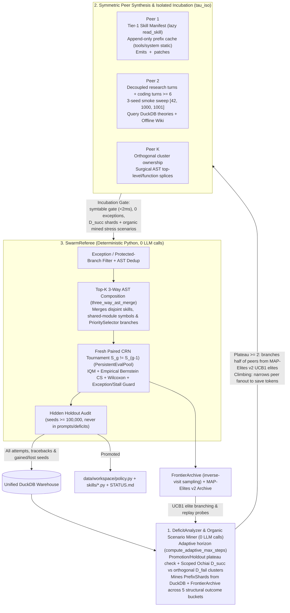

# LOX

**Autonomous empirical policy synthesis under one strict invariant: _Hard Code Nothing_.**

LOX is an empirical program synthesis engine that designs, compiles, statically verifies, instruments, and evolves Python 3.11+ Behavior Tree policies and modular `skills/*.py` packages for long-horizon stochastic environments with permadeath—primarily the **NetHack Learning Environment (NLE)**, with benchmark adapter support for **Craftax**.

Rather than spending API tokens per action like turn-by-turn LLM agents, or millions of reward-shaped frames like end-to-end RL, LOX **decouples offline synthesis from runtime execution**. Peer synthesis agents inspect empirical failure slices, C-engine symbol tables, and game mechanics *between* generations to author compiled Python Behavior Trees that execute directly against the C simulator with zero LLM calls per turn.

---

## Table of Contents

1. [Core Principle: Hard Code Nothing](#1-core-principle-hard-code-nothing)
2. [Democratized Peer Swarm & Organic Scenario Bank](#2-democratized-peer-swarm--organic-scenario-bank)
3. [Behavior Tree Language, 3-Way AST Merge & Compiler Gates](#3-behavior-tree-language-3-way-ast-merge--compiler-gates)
4. [Lossless Environment State, Safe Action I/O & Rust Core](#4-lossless-environment-state-safe-action-io--rust-core)
5. [Unified DuckDB Warehouse, Quality-Diversity & Spectrum Scoring](#5-unified-duckdb-warehouse-quality-diversity--spectrum-scoring)
6. [Single-Agent & Legacy Swarm Modes](#6-single-agent--legacy-swarm-modes)
7. [Repository Layout](#7-repository-layout)
8. [Setup, Verification & CLI Workflows](#8-setup-verification--cli-workflows)
9. [Future Scaling Roadmap (`Path B`)](#9-future-scaling-roadmap-path-b)

---

## 1. Core Principle: Hard Code Nothing

The harness, Rust core, compiler, and referee ([`lox/env/`](lox/env/), [`crates/lox-core/`](crates/lox-core/), [`lox/lang/`](lox/lang/), [`lox/engine/`](lox/engine/)) contain **zero** game strategy heuristics, **zero** monster/corpse/item tier lists, and **zero** hidden tactical adapters. All tactical logic must be synthesized inside `policy.py` and `skills/*.py`.

| Boundary Layer | Responsibility | Implementation |
| :--- | :--- | :--- |
| **Action Interface** | 1-to-1 mapping from policy actions to native NLE C keystrokes (`Action`, `key(ch)`, `seq(...)`, `repeat(...)`, `extcmd(...)`, `DIR_DELTAS`). | [`lox/env/actions.py`](lox/env/actions.py) |
| **Lossless State & WorldMemory** | Lazy zero-copy `GameState` over `blstats`, `BL_MASK_*` flags, `worn_oprop_mask`, 21×79 screen grids (`chars`, `glyphs`, `colors`), multi-floor `FloorMemory` (`remembered_glyphs`, `remembered_colors`, `passable_mask`, trap-avoiding `safe_passable_mask`, `level_exits`, `recent_messages`), and prompt disambiguation (`in_getobj_prompt`, `in_getdir_prompt`, `in_yn_prompt`, `in_text_prompt`, `in_menu`). | [`lox/env/state.py`](lox/env/state.py) |
| **C Symbol Ground Truth** | Direct runtime access to compiled NetHack C structs `permonst` and `objclass` plus accurate glyph-to-trap LUTs (`_TRAP_NAME_BY_GLYPH`). | [`lox/datasets/symbols.py`](lox/datasets/symbols.py), [`lox/env/state.py`](lox/env/state.py) |
| **Safe Harness I/O & Options** | Uses `DEFAULT_NETHACKOPTIONS` (`noautopickup`, putting item pickup strictly under policy control), auto-clears transient `--More--` banners, safely aborts lingered `getobj`/`getdir` prompts with `ESC`, aborts broken multi-keystroke sequences (`seq_aborted`) when a command returns cleanly to `moveloop` in 0 turns, and truncates zero-turn stalls (`stalled_zero_turn`). | [`lox/env/harness.py`](lox/env/harness.py) |

---

## 2. Democratized Peer Swarm & Organic Scenario Bank

The default peer swarm (`--swarm-architecture peer` in [`scripts/run_swarm.py`](scripts/run_swarm.py) and [`SwarmCampaignOrchestrator`](lox/engine/swarm_orchestrator.py)) coordinates symmetric peer agents backed by an **Organic Auto-Mined Scenario Bank**, **100% Fresh Per-Generation Paired CRN Seeds**, and a **Hidden Holdout Gate**:



### Key Safeguards Against Goodharting & Policy Regressions

1. **100% Fresh Paired CRN Seeds + Hidden Holdout Audit ([`swarm_orchestrator.py`](lox/engine/swarm_orchestrator.py), [`swarm_referee.py`](lox/engine/swarm_referee.py))**:
   - Generation `g` evaluates Incumbent and all Peer candidates on a brand-new shared paired seed batch `S_g = [10_000 + g*100 + i]`, ensuring Common Random Numbers (CRN) variance reduction inside every generation while making seed memorization impossible across generations.
   - Candidates that pass the paired tournament (`d_delta` / 25%-trimmed Interquartile Mean `iqm_delta` / Pareto AC/XL/LOC ties via [`evaluate_tournament_pair`](lox/engine/hypothesis.py)) must also clear a **Hidden Holdout Audit** (`seeds >= 100,000`, never exposed to peers or `runs`/`batches` queries; rejects if `holdout_policy_exceptions > 0` or `holdout_iqm_delta < -0.15`).
2. **Organic Auto-Mined Scenario Bank ([`mine_organic_scenarios`](lox/db/shards.py))**:
   - Extracts deterministic real NLE `(seed, cut_byte_idx, action_bytes, post_replay_max_steps)` stress scenarios directly from DuckDB `runs` and `FrontierArchive` across 5 structural outcome buckets (`frontier_deep`, `stall_or_prompt`, `unequipped_crisis`, `resource_or_mortality`, `early_combat_death`) with zero hardcoded game rules.
   - Injected directly into peer incubation alongside `shard_seeds`, enforcing a **strict zero-exception gate** (`policy_exceptions == 0`).
3. **Recency-Scoped Stagnation-Discounted Attribution ([`summarizer.py`](lox/db/summarizer.py), [`swarm_deficits.py`](lox/author/swarm_deficits.py))**:
   - Weights `ochiai_good_run_score` by `(1 - min(0.85, stagnation_share))` and scopes `D_succ` protection in `DeficitAnalyzer` to the latest 1–3 promoted SWARM champion batches with `< 0.35` stagnation share so chronic stall leaves cannot stay frozen as protected branches.
   - Surfaces real rejected/promoted challengers, gained/lost seeds, and tracebacks directly from DuckDB `tournament_attempts`.

---

## 3. Behavior Tree Language, 3-Way AST Merge & Compiler Gates

### Reactive, Interruptible Behavior Trees ([`lox/lang/bt.py`](lox/lang/bt.py))

Policies execute via `PrioritySelector`, `Sequence`, `MemorySequence`, `Inverter`, `ConditionLeaf`, `ActionLeaf`, `BehaviorTree`, and `Blackboard`:
- **Coroutine Leaves & Stateful Sequences**: `ActionLeaf` natively drives Python generator coroutines (`state = yield action` -> `NodeStatus.RUNNING`) and cleans them up automatically via `.halt(blackboard)` -> `gen.close()` whenever a higher-priority branch in `PrioritySelector` preempts them. `MemorySequence` preserves step cursors across `RUNNING` ticks without re-running completed preconditions.
- **Declarative Composition (`@bt_leaf` & `PrioritySelector.from_modules`)**: Modules can export `@bt_leaf(priority=..., before=..., after=..., name=..., min_commit=0)` functions sorted topologically without manual list-wiring boilerplate.
- **Floor-Scoped Memory & Traceback Capture**: `Blackboard.floor_key(state)`, `floor_get`, `floor_set`, and `floor_update` scope dungeon-level state cleanly to `(dungeon_num, level_num)`. Any leaf exception captures the offending `file:line in fn` location and causes smoke tests, incubation, and tournament checks to reject immediately.

### Compile-Time Validation & Compositional Merging ([`lox/lang/validator.py`](lox/lang/validator.py), [`lox/lang/compiler.py`](lox/lang/compiler.py))

1. **Fast `<2ms` `symtable` Undefined-Symbol & Cross-Skill Gate (`check_undefined_symbols`)**: Runs inside `CompiledPolicy.__init__` before touching NLE, catching dormant `NameError`s inside unexecuted branches (e.g. missing helper calls) and missing `skills.<mod>.<attr>` / `from skills.<mod> import <attr>` exports at compile time.
2. **Import/Constant-Safe Skill Splicing (`splice_functions_into_policy` & `merge_skill_module_update`)**: Partial skill patches preserve and union-merge `Import` / `ImportFrom` aliases and update module-level constants even when `target_class is None`.
3. **Top-K 3-Way AST Merging (`three_way_ast_merge`)**: Combines disjoint peer updates—including edits across distinct functions inside the *same* `skills/*.py` file and disjoint child additions inside `PrioritySelector([...])`—and rejects true overlapping conflicts cleanly.
4. **Loop & Escape Sandboxing**: AST validation blocks filesystem/OS/eval escapes; `PolicyInstrumentTransformer` injects `<1 us` per-call tracing, `250,000`-tick loop watchdogs (`PolicyLoopError`), and `self.param(...)` tuning hooks.

---

## 4. Lossless Environment State, Safe Action I/O & Rust Core

- **Lossless Visual & Terrain Memory ([`lox/env/state.py`](lox/env/state.py), [`crates/lox-core/src/replay.rs`](crates/lox-core/src/replay.rs))**:
  - `FloorMemory` stores raw `remembered_chars`, lossless `remembered_glyphs`, and `remembered_colors` without overwriting special terrain symbols (`ice`, `tree`, `iron bars`, `drawbridge`, open doors), exposing both `passable_mask` (keeping discovered traps walkable so corridors are never severed) and `safe_passable_mask` (excluding known traps and `water`/`lava` hazards).
  - `WorldMemory.level_exits` records discovered stairs/ladders/portals per `(dungeon_num, level_num)`, `recent_messages` retains all newly settled messages across multi-keystroke/pager steps, and `GameState.worn_oprop_mask` aggregates intrinsic/property bits from worn/wielded C `objclass` structs.
- **Native Rust PyO3 Acceleration ([`crates/lox-core/`](crates/lox-core/))**:
  - Compiled release extension (`lox_core`) accelerates 21×79 BFS/A* pathfinding (`fast_bfs_distance_grid`, `fast_astar_next_step`), native Behavior Trees (`PyBehaviorTree`, `PyPrioritySelector`, `PySequence`, `PyBlackboard`), and full-grid action-byte replay (`fast_replay_action_bytes` + `fast_update_floor_memory`), with transparent Python/Numba fallback ([`lox/env/grid_utils.py`](lox/env/grid_utils.py)).
- **Prompt & Sequence Safety ([`lox/env/harness.py`](lox/env/harness.py))**:
  - Disambiguates NLE `internal[1]` into `in_getobj_prompt`, `in_getdir_prompt`, and strict `in_yn_prompt` (`--More--` collisions suppressed).
  - Aborts remaining bytes in multi-keystroke `seq(...)` actions (`info["seq_aborted"] = True`) if a leading command returns cleanly to `moveloop` in 0 game turns instead of opening a sub-prompt, preventing trailing slot/direction characters from firing as raw movement or dungeon commands.

---

## 5. Unified DuckDB Warehouse, Quality-Diversity & Spectrum Scoring

All structured telemetry, qualitative peer theories, and tournament challenger outcomes live inside a **single unified DuckDB database** (`data/lox.duckdb`), eliminating multi-store split-brain state:

| Store | Engine & Location | Contents | Access |
| :--- | :--- | :--- | :--- |
| **Unified Analytical & Theory DB** | Embedded columnar SQL ([`schema.py`](lox/db/schema.py), [`theories.py`](lox/db/theories.py), `data/lox.duckdb`) | `batches`, `runs`, `ticks` (tail-sampled), `function_stats`, `policies` (with `skills_json`), `theories`, `tournament_attempts`, `experiments`, `discoveries`, `synthesis_logs` (token & USD spend), `archive_policies`, `llm_cost_rates`, and `expert_runs` / `expert_ticks` (human ascensions). | `query_db(sql)` & `query_theories(query)` |
| **Go-Explore Frontier Archive** | Action-byte checkpoints ([`frontier.py`](lox/engine/frontier.py), `data/frontier/`) | Stores `(seed, depth, action_bytes, visit_count)` from Dlvl 2+ trajectories and prioritizes under-visited deep states via inverse-visit weighting `depth / sqrt(visit_count + 1)`. | Replay probes & organic scenarios |
| **MAP-Elites v2 Vitals Archive** | 5×4×4 80-cell QD grid ([`map_elites.py`](lox/engine/map_elites.py), `archive_policies`) | Non-aliasing coordinates `cell_v2_d{d}_v{v}_t{t}` over **`avg_depth`** × **Vitals Progression** (`AC`, `XP level`, `branches`) × **Spatial Tempo** (`unique_tiles / turns`), with UCB1 + neighbor scarcity `sample_elite("ucb_curiosity")` plateau branching. | DuckDB + `DeficitReport` |
| **Offline NetHack 3.6.6 Wiki** | Local SQLite FTS5 BM25 ([`wiki.py`](lox/datasets/wiki.py), `data/wiki_index.db`) | Complete offline mechanics reference without online latency. | `query_wiki(query)` |

### Prompt-Cache & Research Hygiene ([`author/prompts.py`](lox/author/prompts.py), [`author/agent.py`](lox/author/agent.py), [`author/tools.py`](lox/author/tools.py))

- **Append-Only Prefix Stability**: Keeps `Tools` specs static across turns (`tool_choice="none"` on wrap-up turns instead of stripping `tools`), avoids retroactive `messages` rewrites, applies Anthropic/OpenRouter ephemeral `cache_control` on the static system prompt, and gives `SWARM_PEER` a concise **Tier-1 Skill Manifest** (`skills/<name>.py (LOC) | exports`) + lazy `read_skill` / `read_policy`.
- **Decoupled Research Budget & 3-Seed Smoke Gate**: Refunds `RESEARCH_REQUIRED` turn-1 blocks up to 3 bonus turns so mandatory `query_theories` + `query_wiki` grounding never starves coding turns (`coding_turns >= 6`), and sweeps 3 diverse seeds `[42, 1000, 1001]` in `dry_run_policy(..., smoke_only=True)`.

---

## 6. Single-Agent & Legacy Swarm Modes

- **Single-Agent Loop ([`scripts/run_lox.py`](scripts/run_lox.py), [`orchestrator.py`](lox/engine/orchestrator.py))**: Cycles `CREATE`, `WRITE` (`<= 2` function mutation scope guard), and `REFACTOR` (`>= 450` lines) via [`ModeScheduler`](lox/engine/scheduler.py), gated by paired pilots (`--pilot-revisions 4`), CRN-SPSA parameter tuning ([`modes.py`](lox/engine/modes.py)), Empirical Bernstein Confidence Sequences, Paired Wilcoxon Signed-Rank tests, and Sequential Futility Early Stopping ([`hypothesis.py`](lox/engine/hypothesis.py)).
- **Legacy Hierarchical Swarm**: The earlier `SwarmCriticAgent` + `SwarmMetaAgent` + category `SwarmWorker` topology remains selectable via `--swarm-architecture legacy`.

---

## 7. Repository Layout

```text
crates/lox-core/src/           # PyO3 Rust extension (BT, Blackboard, 21x79 BFS/A*, lossless byte replay)
lox/
├── core/contracts.py          # Typed EpisodeRun, BatchEvaluation, CandidatePackage invariant contracts
├── env/                       # 1-to-1 actions, lazy GameState, WorldMemory, NLE harness, Craftax adapter
├── lang/                      # BehaviorTree/MemorySequence/@bt_leaf, AST validator & 3-way merge, symtable gate, compiler
├── db/                        # Unified DuckDB schema/logger, TheoryDocumentStore, RLE/Ochiai summarizer, PrefixShards
├── datasets/                  # Offline NetHack 3.6.6 Wiki FTS5, C symbol LUTs, expert downloader, frontier bootstrap
├── runner/pool.py             # Persistent multi-core NLE worker pool with traceback & leaf error capture
├── author/                    # AuthorAgent, DeficitAnalyzer, SwarmPeerAgent, tools, Tier-1 prompts, legacy swarm
├── engine/                    # SwarmCampaignOrchestrator, SwarmReferee (Holdout+IQM+Orthogonal), MAP-Elites v2, Frontier
└── ui/console.py              # Compact ANSI console progress & summary tables
scripts/                       # run_swarm.py, run_lox.py, status_lox.py, reset_clean.py, download_experts.py, build_wiki_db.py, calibrate_pilot.py, build_core.sh
tests/                         # 142 automated unit & integration tests
TODO.md                        # Path B future roadmap (MiniHack/.des stress suites, frozen #EVOLVE-BLOCKs)
```

---

## 8. Setup, Verification & CLI Workflows

### 1. Install, Build Rust Extension & Run Tests

```bash
uv sync
uv run maturin develop --release -m crates/lox-core/Cargo.toml   # or ./scripts/build_core.sh
uv run ruff check --fix .
uv run ruff format .
uv run pytest -v               # Runs all 142 tests
```

### 2. Populate Offline Wiki & Human Ascension Corpus

```bash
# Build offline NetHack 3.6.6 Wiki FTS5 index from data/nethackwikidata.json
uv run python scripts/build_wiki_db.py

# Ingest real human ascensions into DuckDB expert_runs / expert_ticks
uv run python scripts/download_experts.py --max-ascensions 1000 --fetch-dumplogs 25

# Optional: seed frontier checkpoints from recorded runs
uv run python lox/datasets/bootstrap_frontier.py --db-path data/lox.duckdb
```

### 3. Run Democratized Peer Swarm Campaigns

```bash
export OPENROUTER_API_KEY="sk-or-v1-..."

# Fresh campaign (--clean resets workspace + campaign DuckDB tables while keeping expert_runs & wiki)
uv run python scripts/run_swarm.py \
  --clean \
  --swarm-architecture peer \
  --provider openrouter \
  --model z-ai/glm-5.3-flash:nitro \
  --workers 4 \
  --turns-per-worker 3 \
  --seeds 24 \
  --generations 10

# Resume & scale up for extended runs (omit --clean to continue from latest gen)
uv run python scripts/run_swarm.py \
  --swarm-architecture peer \
  --provider openrouter \
  --model z-ai/glm-5.3-flash:nitro \
  --workers 4 \
  --eval-workers 16 \
  --turns-per-worker 3 \
  --seeds 24 \
  --generations 50
```

### 4. Offline Smoke Testing & Campaign Monitoring

```bash
# Mock provider end-to-end verification (zero API calls)
uv run python scripts/run_swarm.py --provider mock --generations 2 --workers 2 --turns-per-worker 1 --seeds 2

# Read-only status dashboard, pilot calibration & live workspace status
uv run python scripts/status_lox.py --since-hours 12
uv run python scripts/calibrate_pilot.py --db-path data/lox.duckdb
cat data/workspace/STATUS.md
```

---

## 9. Future Scaling Roadmap (`Path B`)

When Path A + Organic Auto-Mined Scenario Bank clears early/mid-game plateaus toward consistent Vault/Castle/Gehennom depth, constructed `.des` / MiniHack late-game stress suites and AlphaEvolve-style `#EVOLVE-BLOCK` frozen scaffolds can be layered on as tracked in [`TODO.md`](TODO.md).
