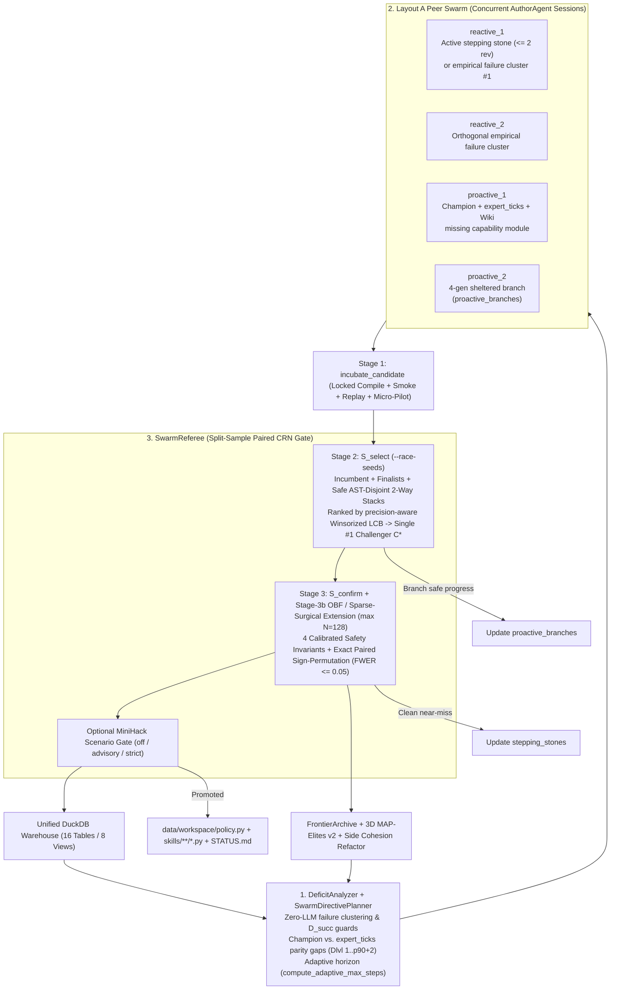

# LOX

**Autonomous empirical policy synthesis under one invariant: _Hard Code Nothing_.**

LOX is an autonomous neurosymbolic policy synthesis engine for long-horizon, partially observable permadeath environments—focused on **NetHack 3.6.6** via the **NetHack Learning Environment (NLE)** and **MiniHack** scenario/prompt-torture verification gates.

Instead of burning LLM tokens on every decision step or training black-box weights over millions of shaped frames, LOX **separates synthesis from runtime execution**:

- **Between generations**, a 4-peer **Layout A (`2R + 2P`)** LLM research swarm inspects a unified DuckDB telemetry warehouse, real human ascension trajectories, C `permonst`/`objclass` ground truth, and an offline NetHackWiki + NetHack 3.6.6 Guidebook index to propose targeted patches across `policy.py` and 1-level / 2-level `skills/` modules.
- **During evaluation**, policies compile into AST-sandboxed Python 3.11+ modules accelerated by a native Rust PyO3 core (`lox_core`) and Numba kernels, executing directly against NLE C bindings at CPU speed under a **3-Stage Split-Sample Paired CRN Promotion Gate (`SwarmReferee`)**.

---

## Contents

1. [Core Invariant: Hard Code Nothing](#1-core-invariant-hard-code-nothing)
2. [Layout A (`2R + 2P`) Peer Swarm & 3-Stage CRN Promotion](#2-layout-a-2r--2p-peer-swarm--3-stage-crn-promotion)
3. [Option-A Policy Language, Sandbox & Starter Architecture](#3-option-a-policy-language-sandbox--starter-architecture)
4. [Environment Harness, Native Rust Core (`lox_core`) & Benchmarks](#4-environment-harness-native-rust-core-lox_core--benchmarks)
5. [DuckDB Telemetry Warehouse, Peer Tools & Archives](#5-duckdb-telemetry-warehouse-peer-tools--archives)
6. [Repository Layout](#6-repository-layout)
7. [Installation, Verification & CLI Workflows](#7-installation-verification--cli-workflows)

---

## 1. Core Invariant: Hard Code Nothing

The harness, Rust extension, AST sandbox/compiler, deficit analyzer, and tournament referee ([`lox/env/`](lox/env/), [`crates/lox-core/`](crates/lox-core/), [`lox/lang/`](lox/lang/), [`lox/engine/`](lox/engine/)) contain **zero** gameplay heuristics, **zero** hardcoded monster/corpse/item tables, and **zero** hidden macro adapters. Domain knowledge lives exclusively inside synthesized policies (`data/workspace/policy.py` and `data/workspace/skills/**/*.py`).

| Layer | Responsibility | Key Modules |
| :--- | :--- | :--- |
| **1-to-1 NLE Actions** | Direct mapping between policy yields/returns and native NLE C keystrokes (`Action` IntEnum, `key(ch)`, `seq(...)`, `repeat(...)`, `extcmd(...)`, `DIR_DELTAS`). | [`lox/env/actions.py`](lox/env/actions.py) |
| **Zero-Copy `GameState` & `WorldMemory`** | Lazy `blstats` (`__slots__`-cached coordinates, HP, AC, XL, conditions, hunger), `BL_MASK_*`, `worn_oprop_mask`, 21x79 grids, per-floor `FloorMemory` (`passable_mask`, `safe_passable_mask`, `door_mask`, `trap_mask`, `level_exits`), and UI prompt detectors. | [`lox/env/state.py`](lox/env/state.py), [`lox/env/memory.py`](lox/env/memory.py), [`lox/env/types.py`](lox/env/types.py) |
| **NLE C Symbol Truth** | Direct queries over NLE `permonst` (`level`, `speed`, `ac`, `mr`, `nutrition`, `cwt`, `conveys`, `resists`, `mflags1`-`3`) and `objclass` (`oclass`, `oclass_name`, `cost`, `weight`, `delay`, `prob`, `oprop`, `descr`). | [`lox/datasets/symbols.py`](lox/datasets/symbols.py) |
| **Safe Harness I/O** | Enforces `noautopickup` (`DEFAULT_NETHACKOPTIONS`), auto-clears `--More--` pagers, aborts invalid `seq(...)` chains in 0 turns, flags text/menu traps (`auto_esc_count`), and breaks zero-turn loops (`stalled_zero_turn`). | [`lox/env/harness.py`](lox/env/harness.py) |

---

## 2. Layout A (`2R + 2P`) Peer Swarm & 3-Stage CRN Promotion

Every campaign runs via [`scripts/run_swarm.py`](scripts/run_swarm.py) and [`SwarmCampaignOrchestrator`](lox/engine/swarm_orchestrator.py):



### How Layout A Works

1. **Deterministic Triage & 1-Shot Scoping ([`swarm_deficits.py`](lox/author/swarm_deficits.py), [`directives.py`](lox/author/directives.py))**:
   - `DeficitAnalyzer` clusters `champion_runs` / `champion_ticks` failures into orthogonal deficits, computes recency-weighted **Ochiai** and **Liblit** function attribution scores over unmasked leaf sub-functions, protects working `D_succ` seeds, and computes normalized `champion_ticks` vs. `expert_ticks` parity gaps across `Dlvl 1..min(10, p90+2)`.
   - `SwarmDirectivePlanner` partitions orthogonal research and editing assignments across the 4 peers (`reactive_1`, `reactive_2`, `proactive_1`, `proactive_2`).
2. **Lifecycle Persistence ([`lifecycle.py`](lox/engine/lifecycle.py))**:
   - **`stepping_stones`**: Near-miss reactive challengers (`min(sign_perm_p, wilcoxon_p, binomial_sign_p) < 0.25`) are picked up by `reactive_1` for up to `2` focused revisions before retiring cleanly.
   - **`proactive_branches`**: `proactive_2` evolves multi-generation capabilities on a sheltered branch for up to `4` generations, advancing whenever `S_select` clears non-catastrophic safety bounds and graduating to Champion only on strict `S_confirm`.
3. **3-Stage Split-Sample Promotion ([`swarm_referee.py`](lox/engine/swarm_referee.py), [`referee_gates.py`](lox/engine/referee_gates.py), [`hypothesis.py`](lox/engine/hypothesis.py))**:
   - **Stage 1 (`incubate_candidate`)**: Lock-protected compile, smoke rollout, failure/frontier checkpoint replays, and horizon-matched CRN micro-pilot (`D_succ` guards + `D_fail` targets + unseen probes) with catastrophe-only depth/latency guards.
   - **Stage 2 (`S_select`)**: Races Incumbent, incubated finalists, and safe AST-disjoint 2-way stacks (composed only from individually safe positive winners via `three_way_ast_merge`) on `--race-seeds`, advancing strictly `#1` challenger `C*` by precision-aware Winsorized LCB.
   - **Stage 3 (`S_confirm` & Stage-3b)**: Confirms `C*` vs. Incumbent on strictly unseen paired seeds (`--seeds`, default `64`), extending by `+64` up to `N=128` via O'Brien-Fleming or Triggered Sparse-Surgical confirmation whenever a specialist wins cleanly on a focused subset (`wins >= 2`, `wins/(wins+losses) >= 0.65`, `wins + losses < 16`), gated on 4 calibrated safety invariants (exceptions, `auto_esc`, paired McNemar `horizon_waste`, paired CVaR-25%) and exact paired Sign-Permutation (`FWER <= 0.05`).

---

## 3. Option-A Policy Language, Sandbox & Starter Architecture

### Option-A Starter Package ([`lox/lang/starter.py`](lox/lang/starter.py))

On a clean start, LOX initializes a zero-heuristic Option-A package under `data/workspace/`:

- `policy.py` — thin `Policy.step(state)` loop calling `ws.observe(state)` → `prompts.handle_prompts` → `survival.check_interrupt` → `combat.check_threat` → `goals.tick` → `goals.fallback_step`.
- `skills/world.py` — `WorldState` and per-`(dungeon_num, level_num)` `FloorCache` (zero-turn obstruction blacklisting, `ws.domain(...)` isolated module state, single-pass `passable_mask` / `safe_passable_mask` / `no_diag_mask` caching).
- `skills/prompts.py`, `skills/survival/core.py`, `skills/combat/core.py`, `skills/navigation/core.py`, `skills/goals/core.py` — bare 1-to-1 `Action` + `GoalRunner` scaffolds with zero hardcoded monsters, items, or heuristics.

### Validation, Sandboxing & Instrumentation ([`lox/lang/`](lox/lang/))

- **AST & Alias Sandbox ([`sandbox.py`](lox/lang/sandbox.py), [`compiler.py`](lox/lang/compiler.py))**: Supports full Python 3.11+ syntax (`class`, `step(state)` / generator `run(state)`, `match/case`, `@dataclass`, type hints, allowlisted stdlib + `numpy`). All preloaded and imported stdlib modules are wrapped in sanitized module proxies (`_make_safe_module_proxy`) stripping `_*`, `FORBIDDEN_IMPORT_NAMES`, and unauthorized submodules across both direct access and aliases; `SAFE_STDLIB_SUBMODULES` (`collections.abc`, `numpy.{linalg,random,fft,ma,exceptions}`) is enforced identically at AST check time and `__import__`.
- **Static & Cross-Module Contracts ([`contracts_check.py`](lox/lang/contracts_check.py), [`splicer.py`](lox/lang/splicer.py), [`bundle.py`](lox/lang/bundle.py))**: Generates dynamic `.pyi` stubs, runs `pyright` + CPython `symtable` undefined-symbol validation, unpacks XML `<policy_code>` / `<skill_code>` blocks and merges `# PATCH` skill updates cleanly (`merge_skill_module_update`) without dropping existing helpers or imports, and merges disjoint improvements via `three_way_ast_merge`.
- **Low-Overhead Leaf Tracer ([`instrument.py`](lox/lang/instrument.py))**: Read-only `_TracerProxy` loop watchdog (`PolicyLoopError`), monotonic generator `frame_id` attribution, primitive fast-path returns, and unmasked sub-function call/turn attribution.
- **Side Cohesion Modularizer ([`modularize.py`](lox/lang/modularize.py))**: Keeps modules bounded outside promotion gating while proving bit-identical `action_bytes` replay parity against live NetHack seeds.

---

## 4. Environment Harness, Native Rust Core (`lox_core`) & Benchmarks

- **Native Rust Core ([`crates/lox-core/src/`](crates/lox-core/src/))**:
  - Compiled via PyO3/maturin (`scripts/build_core.sh`) into `lox_core`, exposing `fast_bfs_distance_grid`, `fast_astar_next_step`, `fast_update_floor_memory`, `fast_extract_exits`, `fast_trap_mask`, and `fast_unexplored_frontier_mask`, with Python/Numba fallback and strict shape validation in [`lox/env/grid_utils.py`](lox/env/grid_utils.py).
- **MiniHack & Prompt-Torture Suites ([`lox/env/benchmarks/nethack_scenarios.py`](lox/env/benchmarks/nethack_scenarios.py))**:
  - Covers procedural `.des` skills (locked doors, kicking, boulders, water/lava hazards, corpses, shops, altars, status conditions) plus NLE C prompt-torture gates (`--More--` collisions, naming text prompts, `[ynq]` traps, menu pagination).
- **Persistent Rollout Pool ([`lox/runner/pool.py`](lox/runner/pool.py))**:
  - Multi-process worker pool with cancellation epochs, leaf-traceback capture, byte-stream checkpoint replay, and CRN seed batching.

---

## 5. DuckDB Telemetry Warehouse, Peer Tools & Archives

### 16-Table / 8-View DuckDB Warehouse ([`lox/db/schema.py`](lox/db/schema.py))

All rollouts, tick traces, discoveries, peer experiments, archives, and human ascensions live in one DuckDB database (default: `data/lox.duckdb`):

| Category | Objects |
| :--- | :--- |
| **Rollouts & Attribution** | `batches`, `runs`, `ticks`, `function_stats` (Ochiai & Liblit scores, `auto_esc_count`, `policy_exceptions`, `worn_oprop_count`, `unique_tiles`, `pct_wait`, `pct_search`) |
| **Lineage & Promotion Lifecycle** | `policies`, `experiments`, `discoveries`, `tournament_attempts`, `stepping_stones`, `proactive_branches` |
| **QD, Memory & Cost Telemetry** | `archive_policies` (3D MAP-Elites v2), `theories` (`TheoryDocumentStore`), `synthesis_logs`, `llm_cost_rates` |
| **Human Reference Corpus** | `expert_runs`, `expert_ticks` |
| **Built-In Analysis Views (8)** | `champion_runs`, `champion_function_stats`, `champion_ticks`, `latest_pilot_runs`, `latest_pilot_ticks`, `peer_runs`, `peer_ticks`, `all_ticks` |

### Read-Only Peer Research & Verification Tools ([`lox/author/tools/`](lox/author/tools/))

Peers investigate empirically using 16 allowlisted tools enforced by a single-pass SQL lexer (`enable_external_access = false`, `SELECT`-only) and snapshot-isolated workspace readers:

- **Telemetry & Parity**: `query_db`, `query_theories`, `benchmark_expert_parity`
- **Reference & C Ground Truth**: `query_wiki`, `read_wiki_article`, `query_monster`, `query_item`, `query_policy_docs`
- **Code Navigation**: `architecture_map`, `read_policy`, `read_skill`, `read_symbol`, `diff_policies`, `find_references`, `grep_skills`
- **Pre-Rollout Gate**: `dry_run_policy` (AST + `pyright` + `symtable` + live replay + scenario/prompt checks + paired micro-pilot)

### Frontier & Archives

- **Go-Explore Frontier Archive ([`lox/engine/frontier.py`](lox/engine/frontier.py), [`lox/datasets/bootstrap_frontier.py`](lox/datasets/bootstrap_frontier.py))**: Byte-stream `action_bytes` checkpoints on Dlvl 2+ prioritizing under-visited deep frontiers.
- **3D MAP-Elites v2 ([`lox/engine/map_elites.py`](lox/engine/map_elites.py))**: Maintains diversity cells for plateau recovery.
- **Offline NetHackWiki Index ([`lox/datasets/wiki.py`](lox/datasets/wiki.py), [`scripts/build_wiki_db.py`](scripts/build_wiki_db.py))**: SQLite FTS5 BM25 index (`data/wiki_index.db`) over NetHackWiki XML dumps and the NetHack 3.6.6 `Guidebook.html`.

---

## 6. Repository Layout

```text
crates/lox-core/src/
├── lib.rs                      # PyO3 module definition (`lox_core`)
├── path.rs                     # Rust BFS distance grids & A* next-step routing
└── replay.rs                   # Action byte replay, FloorMemory update, exits/trap/frontier masks
lox/
├── core/contracts.py           # Typed EpisodeRun, BatchEvaluation, CandidatePackage, invariant guards
├── env/
│   ├── actions.py              # 1-to-1 NLE Action IntEnum, key(), seq(), repeat(), extcmd(), DIR_DELTAS
│   ├── types.py                # MonsterInfo, ObjectInfo, InventoryItem, VisibleMonster/Object, C LUTs
│   ├── memory.py               # FloorMemory & WorldMemory (Rust/Python parity)
│   ├── state.py                # Lazy zero-copy GameState, slot-cached blstats, pathing & prompt flags
│   ├── grid_utils.py           # Rust/Numba BFS & A* wrappers (with strict shape-mismatch checks)
│   ├── harness.py              # Direct C++ NLE harness & deterministic byte replay
│   ├── base.py                 # EnvHarness protocol & BenchmarkAdapter registry
│   ├── nethack/adapter.py      # NetHackBenchmarkAdapter & progression metric
│   └── benchmarks/nethack_scenarios.py  # MiniHack .des curriculum & NLE prompt-torture suites
├── lang/
│   ├── sandbox.py              # Python 3.11+ AST sandbox & SAFE_STDLIB_SUBMODULES enforcement
│   ├── splicer.py              # Surgical AST splicing, 3-way AST merge, #EVOLVE-BLOCK checks
│   ├── contracts_check.py      # Skill key normalization, symtable & pyright verification
│   ├── contracts.py            # Optional GoalIntent / SafetyReport / WorldTracker contracts
│   ├── validator.py            # Re-export facade over sandbox, splicer, and contracts_check
│   ├── instrument.py           # ExecutionTracer, read-only _TracerProxy, loop watchdog, frame_id stack
│   ├── compiler.py             # Sanitized stdlib proxies, scoped __import__, PolicyRunner compiler
│   ├── bundle.py               # XML/Markdown <policy_code> / <skill_code> parser & disk sync
│   ├── modularize.py           # Bit-identical AST side cohesion refactorer
│   └── starter.py              # Zero-heuristic Option-A Gen-0 starter package builder
├── db/
│   ├── schema.py               # 16-table / 8-view DuckDB schema, migrations, cost rates
│   ├── logger.py               # Transactional DuckDB batch/run/tick/lifecycle logger
│   ├── summarizer.py           # RLE trace compression, inflection windows, Ochiai/Liblit scoring
│   ├── shards.py               # Failure & progression PrefixShard extraction
│   └── theories.py             # DuckDB TheoryDocumentStore
├── datasets/
│   ├── wiki.py                 # Offline NetHackWiki + Guidebook 3.6.6 SQLite FTS5 BM25 search
│   ├── symbols.py              # NLE C permonst & objclass lookups
│   ├── download_experts.py     # NAO xlogfile/dumplog/ttyrec ingestion into expert_runs/expert_ticks
│   └── bootstrap_frontier.py   # FrontierArchive bootstrap from recorded DuckDB runs
├── runner/pool.py              # Persistent multi-core NLE rollout & tournament worker pool
├── author/
│   ├── prompts.py              # Static Layout A system prompt & turn-0 user context builder
│   ├── directives.py           # 1-shot SwarmDirectivePlanner, prune_unused_skills, branch extractor
│   ├── llm_client.py           # Provider-first API key resolver, HTTP retry client, usage tracking
│   ├── parsing.py              # Safe YAML/Python/skill/tool-arg extraction helpers
│   ├── agent.py                # Stateless AuthorAgent with compiler-in-the-loop self-repair
│   ├── swarm_deficits.py       # Empirical DeficitAnalyzer & expert-parity gap mining
│   ├── swarm_peer.py           # SwarmPeerAgent & isolated sandbox incubation
│   └── tools/                  # Modular OpenAI tool registry (specs, db_tools, code_tools, dry_run, micro_pilot)
├── engine/
│   ├── hypothesis.py           # Exact Sign-Permutation, Wilcoxon, Winsorized, CVaR & OBF tests
│   ├── referee_gates.py        # TournamentVerdict, safety invariants, stepping-stone selector
│   ├── swarm_referee.py        # 3-Stage Split-Sample CRN SwarmReferee & AST stacker
│   ├── lifecycle.py            # Stepping-stone, proactive-branch & Layout A assignment lifecycles
│   ├── reporting.py            # Adaptive max_steps & campaign STATUS.md report writer
│   ├── swarm_orchestrator.py   # End-to-end Layout A SwarmCampaignOrchestrator
│   ├── frontier.py             # Go-Explore byte-replay frontier archive
│   └── map_elites.py           # 3D MAP-Elites v2 diversity archive
└── ui/console.py               # Thread-safe compact ANSI console UI
scripts/
├── run_swarm.py                # Main CLI entrypoint for Layout A Peer Swarm synthesis campaigns
├── status_lox.py               # Read-only DuckDB campaign & spend check-in dashboard
├── build_wiki_db.py            # Builds data/wiki_index.db from NetHackWiki XML + Guidebook 3.6.6
├── download_experts.py         # Populates expert_runs / expert_ticks in DuckDB
├── modularize_policy.py        # Standalone AST modularizer CLI with parity check
├── reset_clean.py              # Clean workspace & campaign reset utility (keeps wiki/experts)
└── build_core.sh               # Builds & installs lox-core via maturin --release
tests/                          # 196 unit, contract, regression & integration tests
```

---

## 7. Installation, Verification & CLI Workflows

### 1. Install Dependencies, Build Rust Core & Run All Gates

```bash
uv sync
./scripts/build_core.sh          # builds & installs lox_core (--release)
uv run ruff check .
uv run ruff format --check .
uv run pyright lox/              # target: 0 errors
uv run pytest -v                 # 196 tests
```

### 2. Populate Offline Wiki & Human Expert Corpus (One-Time Setup)

```bash
# Downloads NetHackWiki XML + NetHack 3.6.6 Guidebook and builds data/wiki_index.db
uv run python scripts/build_wiki_db.py --download-xml

# Ingests NAO human ascensions into DuckDB expert_runs / expert_ticks
uv run python scripts/download_experts.py --max-ascensions 1000 --fetch-dumplogs 25
```

### 3. Run a Layout A (`2R + 2P`) Synthesis Campaign

Set `OPENROUTER_API_KEY` (or your chosen provider key) in `.env`:

```bash
# Fresh campaign (--clean resets workspace & campaign tables while keeping wiki & expert_runs)
uv run python scripts/run_swarm.py \
  --clean \
  --provider openrouter \
  --model z-ai/glm-5.3-flash:nitro \
  --refactor-model <optional-stronger-model> \
  --reasoning-effort medium \
  --workers 4 \
  --turns-per-worker 3 \
  --seeds 64 \
  --race-seeds 32 \
  --scenario-gate off \
  --generations 50

# Resume an existing campaign in-place (omit --clean)
uv run python scripts/run_swarm.py \
  --provider openrouter \
  --model z-ai/glm-5.3-flash:nitro \
  --workers 4 \
  --seeds 64 \
  --race-seeds 32 \
  --generations 50
```

> **Note:** On `scripts/run_swarm.py`, `--generations` defaults to `5`, `--workers` defaults to `4`, `--seeds` defaults to `64`, `--race-seeds` defaults to `32`, and `--scenario-gate` defaults to `off`.

### 4. Offline Smoke Check & Live Telemetry Dashboard

```bash
# Offline end-to-end mock campaign check (0 external API calls)
uv run python scripts/run_swarm.py \
  --provider mock \
  --generations 2 \
  --workers 4 \
  --turns-per-worker 1 \
  --seeds 8 \
  --race-seeds 4

# Read-only campaign status & telemetry inspection (safe during active runs)
uv run python scripts/status_lox.py --db-path data/lox.duckdb --since-hours 12
cat data/workspace/STATUS.md
```
