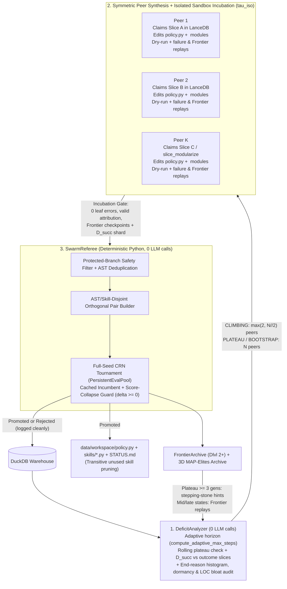

# LOX

**Autonomous empirical policy synthesis under one invariant: _Hard Code Nothing_.**

LOX is an empirical program synthesis engine that designs, compiles, instruments, verifies, and evolves executable Python 3.11+ Behavior Tree policies and modular skill packages for long-horizon stochastic environments with permadeath—primarily the **NetHack Learning Environment (NLE)**, with benchmark adapter support for **Craftax**.

Two paradigms usually struggle on NetHack for opposite reasons:
- **End-to-end RL** requires massive frame budgets to shape opaque weights against sparse, delayed rewards and combinatorial item/monster mechanics.
- **Turn-by-turn LLM agents** pay seconds of latency and API tokens on every keystroke, making large-sample paired evaluation financially and temporally impractical.

LOX resolves this by **decoupling offline synthesis from runtime execution**: LLM peer agents run only *between* generations to inspect SQL telemetry, episode summaries, C engine symbol tables, and wiki mechanics—synthesizing compiled Behavior Trees and Python skill modules that execute directly against the C simulator with zero LLM calls per turn.

---

## Table of Contents

1. [Core Principle: Hard Code Nothing](#1-core-principle-hard-code-nothing)
2. [Democratized Peer Swarm Architecture](#2-democratized-peer-swarm-architecture)
3. [Execution Pipeline: AST Instrumentation, Behavior Trees & Rust Core](#3-execution-pipeline-ast-instrumentation-behavior-trees--rust-core)
4. [Telemetry Summarization, Confinement Detection & Spectrum Attribution](#4-telemetry-summarization-confinement-detection--spectrum-attribution)
5. [Dual-Store Warehouse & Quality-Diversity Archives](#5-dual-store-warehouse--quality-diversity-archives)
6. [Single-Agent & Legacy Swarm Modes](#6-single-agent--legacy-swarm-modes)
7. [Repository Layout](#7-repository-layout)
8. [Setup, Verification & CLI Workflows](#8-setup-verification--cli-workflows)

---

## 1. Core Principle: Hard Code Nothing

The evaluation harness and compiler ([`lox/env/`](lox/env/), [`lox/lang/`](lox/lang/)) contain **zero** game strategy heuristics, **zero** hardcoded monster/corpse/item tier lists, and **zero** hidden macro adapters. Every piece of tactical intelligence must be discovered and written inside synthesized Python policy code.

| Boundary Layer | Responsibility | Implementation |
| :--- | :--- | :--- |
| **Action Interface** | Pure 1-to-1 mapping between policy yields and native C actions (`Action`, `key(ch)`, `seq(...)`, `DIR_DELTAS`). | [`lox/env/actions.py`](lox/env/actions.py) |
| **State Exposure** | Lazy zero-copy `GameState` wrapping `blstats` (e.g. `NLE_BL_SCORE` at index `9` with tombstone preservation), `BL_MASK_*` status bitmasks, 21×79 screen grids (`chars`, `glyphs`, `colors`, `specials`), inventory summaries, and `WorldMemory`. | [`lox/env/state.py`](lox/env/state.py) |
| **C Engine LUTs** | Direct runtime access to compiled NetHack C structs: `nle.nethack.permonst` (`state.mon_info(y, x)`) and `nle.nethack.objclass` (`state.obj_info(glyph)`). | [`lox/datasets/symbols.py`](lox/datasets/symbols.py) |
| **Prompt & Stall Guards** | Auto-clears `--More--` pagination (`SPACE`), surfaces `in_yn_prompt` and `in_text_prompt` directly to policies with watchdog protection, and truncates zero-turn loops (`stalled_zero_turn`). | [`lox/env/harness.py`](lox/env/harness.py) |

---

## 2. Democratized Peer Swarm Architecture

The default swarm (`--swarm-architecture peer` in [`scripts/run_swarm.py`](scripts/run_swarm.py) and [`SwarmCampaignOrchestrator`](lox/engine/swarm_orchestrator.py)) replaces top-down `Critic`/`Meta` bottlenecks and arbitrary thematic worker silos with **symmetric, data-assigned peer agents** validated in isolated sandboxes and paired Common Random Numbers (CRN) tournaments:



### Detailed Pipeline Stages

1. **Deterministic Deficit Partitioning & Adaptive Horizon ([`swarm_deficits.py`](lox/author/swarm_deficits.py), [`swarm_orchestrator.py`](lox/engine/swarm_orchestrator.py))**:
   - **Dynamic `max_steps` Scaling**: Reuses `compute_adaptive_max_steps` against the latest promoted batch's `p90_depth` (`5,000 → 10,000 → 18,000 → 30,000 → 50,000` steps) so early stalled runs terminate quickly while deep multi-branch runs never get artificially cut off.
   - **Plateau-Adaptive Peer Concurrency (`CLIMBING` vs `PLATEAU`)**: Narrows active peers (`max(2, workers // 2)`) during steady depth gains to save tokens/churn, and fans out to full `--workers` on plateaus or bootstraps.
   - **Zero-Heuristic Trajectory Slices & Raw Histogram (`D_succ` vs `D_fail`)**: Identifies `is_outlier_good` / top-depth seeds (`d_succ_seeds`) and high-Ochiai active BT leaves (`protected_branches`), surfaces the raw recent `end_reason` histogram, and splits non-optimal runs purely on numerical trajectory shape (`slice_stalled`, `slice_safety_traps`, `slice_frontier_failures`, `slice_early_terminations`, `slice_median_outcomes`, plus `slice_modularize` when `policy_loc >= 400` or `dormant_branches` accumulate).
   - **MAP-Elites Plateau Stepping Stones**: After `>= 3` consecutive non-promoted generations, injects top `MAPElitesArchive` policy snapshots into `DeficitReport.plateau_hints` so peers can inspect (`read_policy`) diverse behavioral niches.

2. **Symmetric Peer Authoring & Isolated Incubation ([`swarm_peer.py`](lox/author/swarm_peer.py))**:
   - Every `SwarmPeerAgent` runs in `SWARM_PEER` mode with full codebase editing rights and identical tools (`query_db` with automatic DuckDB `Binder Error` / `Catalog Error` schema column hints, `query_wiki`, `query_monster`, `query_item`, `read_policy`, `diff_policies`, `read_skill`, `dry_run_policy`).
   - Supports modular skill extraction via both `<skill_code module="name">...</skill_code>` and `### skill: <name>` blocks ([`agent.py`](lox/author/agent.py)), alongside `skills_to_prune` YAML lists and transitive AST pruning.
   - During `incubate_candidate()`, every peer candidate must pass:
     1. AST validation & compilation under `_COMPILE_EXEC_LOCK`.
     2. 60-step smoke check (`WAIT`-deadlock rejection + wrapper attribution audit + zero swallowed `Blackboard.leaf_errors`).
     3. Failure-fixture replay probes (`replay_fixtures`) AND high-depth `FrontierCheckpoint` probes (`frontier.replay_into` + `100` live steps via shared `_run_replay_probe`).
     4. Multi-core paired micro-shard evaluation (`D_succ` guards + `D_fail` sample seeds + baseline seeds) against cached Incumbent shard runs.

3. **Deterministic CRN Tournament & Score-Collapse Guard ([`swarm_referee.py`](lox/engine/swarm_referee.py))**:
   - **Decoupled Multi-Core Rollout Pool (`--eval-workers`)**: `PersistentEvalPool` scales CPU NLE workers up to `16` (bounded by `--seeds` and CPU cores, or explicit `--eval-workers`) independently of the `--workers` LLM peer count.
   - **Incumbent CRN Cache**: Caches `(eval_pool, package_fingerprint, seeds, max_steps)` across generations so unchanged Incumbents are not re-evaluated unnecessarily, while automatically re-evaluating whenever the code changes or `max_steps` scales to a new tier.
   - **AST/Skill-Disjoint Orthogonal Pairing**: If the top-2 incubated survivors edit disjoint `skills/*.py` modules and disjoint BT branches (at most one editing `policy.py`), `build_orthogonal_pair` compiles and enters a combined candidate alongside the individual finalists.
   - **Non-Regression + Score-Collapse Guard**: Evaluates all finalists across every paired seed in the full CRN tournament. Rejects regressions and prevents marginal depth gains (`< 0.50`) from overriding severe score collapses (`avg_score < 0.70 * inc_score` when `inc_score >= 50`), logging every rejected batch honestly (`is_promoted=False`) while keeping the Incumbent intact in `data/workspace/`.

---

## 3. Execution Pipeline: AST Instrumentation, Behavior Trees & Rust Core

### Sandboxed Compiler & AST Instrumentation ([`lox/lang/`](lox/lang/))

Candidate packages (`policy.py` + `skills/*.py`) pass through three compile/runtime stages:
1. **Static Safety Validation ([`validator.py`](lox/lang/validator.py))**: Parses Python 3.11+ ASTs, blocks unsafe imports/builtins (`open`, `exec`, `eval`, `os`, `subprocess`, `sys`), enforces contract invariants, and handles function splicing (`splice_functions_into_policy`).
2. **Compile-Time Instrumentation ([`instrument.py`](lox/lang/instrument.py))**: `PolicyInstrumentTransformer` injects `ExecutionTracer` hooks with sub-microsecond overhead: loop watchdogs (`PolicyLoopError` at `250,000` ticks), per-function call/turn tracking, and `self.param(name, default, min_val, max_val)` tunable parameters.
3. **Unified Runner ([`compiler.py`](lox/lang/compiler.py))**: `PolicyRunner` drives generator policies (`def run`), step policies (`def step`), callable policies, and Behavior Trees uniformly.

### Behavior Trees & Native Hysteresis ([`lox/lang/bt.py`](lox/lang/bt.py))

Policies coordinate reactive subsystems through `PrioritySelector`, `Sequence`, `Inverter`, `ConditionLeaf`, `ActionLeaf`, and a shared `Blackboard`:
- **Exact Leaf Attribution**: `ActionLeaf.tick` records `self.name` onto `Blackboard.last_active_leaf`. `PolicyRunner.next_action` resets `last_active_leaf` per turn and credits `ExecutionTracer.record_turn_yield(preferred_fn=...)` so helper wrappers never mask leaf attribution.
- **Native Commitment Hysteresis**: `ActionLeaf(..., min_commit=N)` and `PrioritySelector(..., hysteresis=N)` persist child commitment in `Blackboard._selector_commits` until `FAILURE` or expiry, eliminating step-to-step action thrashing inside the tree itself.

### Rust PyO3 Native Core ([`crates/lox-core/`](crates/lox-core/))

Optional native Rust extension (`lox_core`) exposing zero-allocation Behavior Tree classes (`PyNodeStatus`, `PyBlackboard`, `PyActionLeaf`, `PyConditionLeaf`, `PyPrioritySelector`, `PySequence`, `PyBehaviorTree`), stack-allocated 21×79 BFS/A* grid pathfinding (`fast_bfs_distance_grid`, `fast_astar_next_step`), and byte-stream replay (`fast_replay_action_bytes`), with transparent Numba/Python fallback ([`grid_utils.py`](lox/env/grid_utils.py)).

---

## 4. Telemetry Summarization, Confinement Detection & Spectrum Attribution

[`lox/db/summarizer.py`](lox/db/summarizer.py) compresses raw trajectories into diagnostic digests:
1. **RLE Phase Timelines & Inflections**: Merges consecutive turns by `(depth, active_function)` with action histograms, tile counts, top HP/depth/score inflection windows, and termination tails.
2. **Single-Segment & Multi-Segment Confinement Stalls**: Detects both tight single-function loops (`steps >= 40`, `<= 3` positions) and sliding-window (`120` ticks, stride `30`) multi-leaf spatial confinement (`CONFINEMENT_STALL`, catching alternating movement + `SEARCH` loops inside small rooms/corridors).
3. **Outlier & Spectrum Scoring**: Marks statistical exception runs (`is_outlier_good`) via Z-score/IQR and computes `ochiai_good_run_score`, `liblit_failure_score`, `stagnation_share`, and `livelock_score` per function in `function_stats`.

---

## 5. Dual-Store Warehouse & Quality-Diversity Archives

| Store | Engine & Location | Primary Tables / Contents | Access Tool |
| :--- | :--- | :--- | :--- |
| **DuckDB Analytical Warehouse** | Embedded columnar SQL ([`schema.py`](lox/db/schema.py), `data/lox.duckdb`) | `batches`, `runs` (incl. `created_at`), `ticks` (tail-sampled), `function_stats`, `policies` (with `skills_json`), `experiments`, `discoveries`, `synthesis_logs` (with per-call token & USD cost), `llm_cost_rates`, and `expert_runs` / `expert_ticks` (consolidated human ascensions). | `query_db(sql)` |
| **LanceDB Document Store** | Embedded Arrow + Tantivy BM25 FTS ([`theories.py`](lox/db/theories.py), `theories.lance`) | Peer `PEER_CLAIM` records, hypotheses, and reflections. | `query_theories(query)` |

Supporting archives preserve multi-depth states and behavioral diversity:
- **Go-Explore Frontier Archive ([`frontier.py`](lox/engine/frontier.py))**: Saves raw action-byte prefixes from Dlvl 2+ runs in `data/frontier/` for ~15 ms replay back into mid/late-game states inside `dry_run_policy` and `incubate_candidate` (or bootstrap from DuckDB via [`bootstrap_frontier.py`](lox/datasets/bootstrap_frontier.py)).
- **3D MAP-Elites Diversity Archive ([`map_elites.py`](lox/engine/map_elites.py))**: Maintains an 80-cell archive indexed over `Depth (5) × Wait/Search Caution (4) × Score Density (4)` across winning and runner-up candidates.
- **Offline NetHack 3.6.6 Wiki ([`wiki.py`](lox/datasets/wiki.py))**: Local SQLite FTS5 BM25 index (`data/wiki_index.db`) queried via `query_wiki(query)`.

---

## 6. Single-Agent & Legacy Swarm Modes

- **Single-Agent Loop ([`scripts/run_lox.py`](scripts/run_lox.py), [`orchestrator.py`](lox/engine/orchestrator.py))**: Alternates `CREATE`, `WRITE` (`<= 2` functions mutation guard), and `REFACTOR` (`>= 450` lines) via [`ModeScheduler`](lox/engine/scheduler.py), gated by paired `dry_run_policy` pilots (`--pilot-revisions 4`, negative-delta abort), CRN-SPSA parameter tuning ([`modes.py`](lox/engine/modes.py)), Empirical Bernstein Confidence Sequences, Paired Wilcoxon Signed-Rank tests, and Sequential Futility Early Stopping ([`hypothesis.py`](lox/engine/hypothesis.py)).
- **Legacy Hierarchical Swarm**: The previous `SwarmCriticAgent` + `SwarmMetaAgent` + category `SwarmWorker` flow remains selectable via `--swarm-architecture legacy`.

---

## 7. Repository Layout

```text
crates/lox-core/src/           # PyO3 Rust core (BT, Blackboard, 21x79 BFS/A*, byte replay)
lox/
├── core/contracts.py          # Typed EpisodeRun, BatchEvaluation, CandidatePackage contracts
├── env/                       # 1-to-1 actions, lazy GameState, NLE harness, Craftax adapter, grid_utils
├── lang/                      # BehaviorTree/Blackboard, AST validator, ExecutionTracer, compiler, macros
├── db/                        # DuckDB schema/logger, RLE & confinement summarizer, PrefixShards, LanceDB
├── datasets/                  # Offline NetHack 3.6.6 Wiki FTS5, C symbol LUTs, expert downloader, frontier bootstrap
├── runner/pool.py             # Persistent multi-core NLE worker pool
├── author/                    # AuthorAgent, DeficitAnalyzer, SwarmPeerAgent, tools, prompts, legacy Critic/Meta/Worker
├── engine/                    # SwarmCampaignOrchestrator, SwarmReferee, CampaignOrchestrator, hypothesis, SPSA, Frontier, MAP-Elites
└── ui/console.py              # Compact ANSI console progress & summary tables
scripts/                       # run_swarm.py, run_lox.py, status_lox.py, reset_clean.py, download_experts.py, build_wiki_db.py, calibrate_pilot.py, build_core.sh
tests/                         # 122 automated unit & integration tests
```

---

## 8. Setup, Verification & CLI Workflows

### 1. Install, Build Rust Extension & Run Tests

```bash
uv sync
./scripts/build_core.sh        # Optional native PyO3 Rust acceleration
uv run ruff check --fix .
uv run ruff format .
uv run pytest -v               # Runs all 122 tests
```

### 2. Populate Offline Wiki & Human Ascension Corpus

```bash
# Build offline NetHack 3.6.6 Wiki FTS5 index from data/nethackwikidata.json
uv run python scripts/build_wiki_db.py

# Ingest real human ascensions into DuckDB expert_runs / expert_ticks
uv run python scripts/download_experts.py --max-ascensions 1000 --fetch-dumplogs 25

# Optional: seed frontier checkpoints from recorded runs
uv run python lox/datasets/bootstrap_frontier.py --db-path data/lox.duckdb
```

### 3. Run Democratized Peer Swarm Campaigns

```bash
export OPENROUTER_API_KEY="sk-or-v1-..."

# Fresh campaign (--clean resets workspace + campaign tables while keeping expert_runs & wiki)
uv run python scripts/run_swarm.py \
  --clean \
  --swarm-architecture peer \
  --provider openrouter \
  --model z-ai/glm-5.3-flash:nitro \
  --workers 4 \
  --turns-per-worker 3 \
  --seeds 24 \
  --generations 10

# Resume & scale up for extended/overnight runs (omit --clean to continue from latest gen)
uv run python scripts/run_swarm.py \
  --swarm-architecture peer \
  --provider openrouter \
  --model z-ai/glm-5.3-flash:nitro \
  --workers 4 \
  --eval-workers 16 \
  --turns-per-worker 3 \
  --seeds 24 \
  --generations 50
```

### 4. Offline Smoke Testing & Campaign Monitoring

```bash
# Mock provider end-to-end verification (zero API calls)
uv run python scripts/run_swarm.py --provider mock --generations 2 --workers 2 --turns-per-worker 1 --seeds 2

# Read-only status dashboard (depth, score, LLM spend), pilot calibration & live logs
uv run python scripts/status_lox.py --since-hours 12
uv run python scripts/calibrate_pilot.py --db-path data/lox.duckdb
cat data/workspace/STATUS.md
tail -f data/workspace/campaign_errors.log
```
