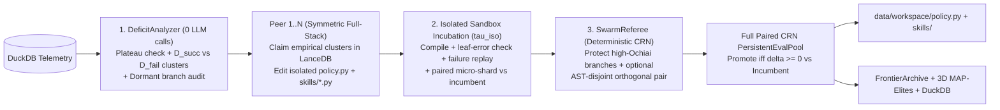

# LOX

**Autonomous empirical policy synthesis under one rule: _Hard Code Nothing_.**

LOX synthesizes, verifies, attributes, and evolves executable Python 3.11+ Behavior Tree policies and modular skill libraries for long-horizon stochastic environments with permadeath—primarily the **NetHack Learning Environment (NLE)**, with benchmark adapter support for **Craftax**.

Instead of using LLM calls turn-by-turn at runtime or hardcoding monster/item/nutrition heuristics in the harness, LOX separates **synthesis** from **execution**: LLM peers inspect empirical execution telemetry and offline references offline/between generations, while compiled Python + Rust-accelerated Behavior Trees execute directly against the C simulator at native speed with zero per-turn LLM calls.

---

## Table of Contents

1. [Core Principle: Hard Code Nothing](#1-core-principle-hard-code-nothing)
2. [Democratized Peer Swarm Architecture](#2-democratized-peer-swarm-architecture)
3. [Behavior Trees, Hysteresis & Native Acceleration](#3-behavior-trees-hysteresis--native-acceleration)
4. [Telemetry, Summarization & Spectrum Attribution](#4-telemetry-summarization--spectrum-attribution)
5. [Dual-Store Memory (DuckDB + LanceDB) & Archives](#5-dual-store-memory-duckdb--lancedb--archives)
6. [Single-Agent & Legacy Swarm Modes](#6-single-agent--legacy-swarm-modes)
7. [Repository Layout](#7-repository-layout)
8. [Setup, Testing & CLI Usage](#8-setup-testing--cli-usage)

---

## 1. Core Principle: Hard Code Nothing

The execution harness ([`lox/env/`](lox/env/)) contains **zero** game strategy heuristics, **zero** hardcoded monster/corpse/item tables, and **zero** hidden macro adapters:

- **1-to-1 Action Interface ([`actions.py`](lox/env/actions.py))**: Policies yield native `Action` enum values, raw keys (`key(ch)`), or multi-keystroke sequences (`seq(...)`).
- **Lazy Game State ([`state.py`](lox/env/state.py))**: Exposes `blstats`, status bitmasks (`BL_MASK_*`), 21×79 screen grids (`chars`, `glyphs`, `colors`, `specials`), inventory summaries, `WorldMemory` tile memory, spatial grid utilities ([`grid_utils.py`](lox/env/grid_utils.py)), and direct C symbol-table lookups over `nle.nethack.permonst` and `nle.nethack.objclass` ([`datasets/symbols.py`](lox/datasets/symbols.py)).
- **Prompt & Stall Guards ([`harness.py`](lox/env/harness.py))**: Auto-dismisses `--More--` pagination (`SPACE`), passes real `yn`/`getlin` and naming prompts (`in_yn_prompt`, `in_text_prompt`) directly to the policy with a safety watchdog, and truncates zero-turn action loops (`stalled_zero_turn`).
- **Sandboxed Python 3.11+ Runtime ([`lox/lang/`](lox/lang/))**: Supports classes, generators (`yield` / `yield from`), `match/case`, comprehensions, `@dataclass`, and curated stdlib/scientific modules (`math`, `collections`, `heapq`, `itertools`, `functools`, `re`, `numpy`, `random`, `bisect`, `copy`). AST instrumentation ([`instrument.py`](lox/lang/instrument.py)) injects loop watchdogs (`PolicyLoopError`), call/turn tracing (`ExecutionTracer`), and tunable parameters (`self.param(...)`).

---

## 2. Democratized Peer Swarm Architecture

The default swarm (`--swarm-architecture peer` in [`scripts/run_swarm.py`](scripts/run_swarm.py) and [`SwarmCampaignOrchestrator`](lox/engine/swarm_orchestrator.py)) replaces fixed thematic worker silos and top-down `Critic`/`Meta` bottlenecks with **symmetric, data-assigned peer agents** validated in isolation before promotion:



### Generation Lifecycle

1. **Deterministic Deficit Partitioning ([`swarm_deficits.py`](lox/author/swarm_deficits.py))**:
   - **Plateau-Adaptive Concurrency**: Computes rolling depth progression across recent `SWARM` batches (`CLIMBING` vs `PLATEAU`). Climbing runs spawn fewer peers (`max(2, workers // 2)`); plateaus and bootstraps fan out to full `workers`.
   - **`D_succ` vs `D_fail`**: Identifies `is_outlier_good` / top-depth runs and high-Ochiai BT branches (`protected_branches`) alongside empirical failure clusters (`confinement_stall`, `safety_and_prompts`, mortality clusters, and `0`-turn `dormant_cleanup`).
2. **Symmetric Peer Synthesis & Isolated Incubation ([`swarm_peer.py`](lox/author/swarm_peer.py))**:
   - Each `SwarmPeerAgent` operates in `SWARM_PEER` mode with identical access to `query_db`, `query_wiki`, `query_monster`, `query_item`, `read_policy`, `diff_policies`, `read_skill`, and `dry_run_policy`.
   - Peers claim distinct empirical clusters on LanceDB (`PEER_CLAIM`), edit full candidate packages in isolation, prune unused skills transitively, and pass `incubate_candidate()` against a paired micro-shard (`D_succ` guards + `D_fail` sample seeds + baseline seeds + failure-replay fixtures). Candidates with swallowed leaf exceptions, `WAIT`-only deadlocks, or guard regressions are rejected inside the sandbox.
3. **Deterministic CRN Tournament & Orthogonal Pairing ([`swarm_referee.py`](lox/engine/swarm_referee.py))**:
   - Filters survivors for protected-branch safety and deduplicates identical ASTs.
   - If the top-2 survivors modify disjoint `skills/` modules and disjoint BT branches (with at most one modifying `policy.py`), `build_orthogonal_pair` constructs and compiles one combined candidate for head-to-head testing alongside single-peer finalists.
   - `evaluate_tournament` runs the Incumbent and finalists on identical paired seeds (`PersistentEvalPool`) and promotes a winner **only if** progression is non-regressive (`delta >= 0`). Regressive generations retain the Incumbent in `data/workspace/` while still logging full batch telemetry (`is_promoted=False`) for the next generation to inspect.

---

## 3. Behavior Trees, Hysteresis & Native Acceleration

Policies compose modular Behavior Trees via [`lox/lang/bt.py`](lox/lang/bt.py):

```python
from lox.env.actions import Action, DIR_DELTAS
from lox.lang.bt import ActionLeaf, BehaviorTree, Blackboard, PrioritySelector

class Policy:
    def __init__(self):
        self.blackboard = Blackboard()
        root = PrioritySelector(
            [
                ActionLeaf(handle_prompts, name="dialog_leaf"),
                ActionLeaf(engage_adjacent, name="combat_leaf"),
                ActionLeaf(explore_level, name="explore_leaf", min_commit=3),
            ],
            name="MasterSelector",
        )
        self.tree = BehaviorTree(root=root, blackboard=self.blackboard)

    def step(self, state):
        return self.tree.tick(state) or Action.SEARCH
```

- **Exact Leaf Attribution**: `ActionLeaf.tick` writes the winning `self.name` onto `Blackboard.last_active_leaf`, and `PolicyRunner.next_action` credits `ExecutionTracer.record_turn_yield(preferred_fn=...)` so per-leaf turns remain accurate even if helper functions wrap actions.
- **Native Hysteresis Commitment**: `ActionLeaf(..., min_commit=N)` and `PrioritySelector(..., hysteresis=N)` hold multi-step commitment on `Blackboard` until the branch completes/returns `FAILURE` or the commit window expires, avoiding ad-hoc post-step oscillation wrappers.
- **Zero-Allocation Rust Acceleration ([`crates/lox-core/`](crates/lox-core/))**: PyO3 native extension (`lox_core`) accelerating `PyBehaviorTree`, `PyBlackboard`, stack-allocated 21×79 BFS/A* grid pathfinding, and fast byte-stream replay, with automatic fallback to Numba/Python when unavailable.

---

## 4. Telemetry, Summarization & Spectrum Attribution

- **Episode Summarizer ([`summarizer.py`](lox/db/summarizer.py))**: Compresses episode ticks into Run-Length Encoded timelines (`(depth, active_function)`), critical HP/depth/score inflection windows, single-segment stalls, and sliding-window multi-segment **spatial confinement loops** (`CONFINEMENT_STALL`, detecting multi-leaf oscillation inside bounded rooms/corridors across 120-tick windows).
- **Outlier & Fault Scoring**: Flags statistical exceptions (`is_outlier_good`, Z-score/percentile) and computes per-function `ochiai_good_run_score`, `liblit_failure_score`, `stagnation_share`, and `livelock_score` in DuckDB `function_stats`.
- **Honest Tool Telemetry ([`agent.py`](lox/author/agent.py), [`tools.py`](lox/author/tools.py))**: Distinguishes check-only `dry_run_policy` smoke/replay runs (`DRY_RUN_CHECK` / `DRY_RUN_PASSED` / `DRY_RUN_FAILED`) from paired rollout pilots (`PILOT_EXECUTION` / `PILOT_IMPROVED` / `PILOT_FAILED`).

---

## 5. Dual-Store Memory (DuckDB + LanceDB) & Archives

- **DuckDB Analytical Warehouse ([`schema.py`](lox/db/schema.py), [`logger.py`](lox/db/logger.py))**: Stores `batches`, `runs`, tail-sampled `ticks`, `function_stats`, versioned `policies` (with `skills_json`), `experiments`, `synthesis_logs` (including per-call token & USD cost tracking), and consolidated human ascension corpora (`expert_runs`, `expert_ticks`).
- **LanceDB Theory Store ([`theories.py`](lox/db/theories.py))**: Embedded columnar store with Tantivy BM25 full-text search for peer deficit claims (`PEER_CLAIM`), theories, and reflections.
- **Frontier Checkpoints ([`frontier.py`](lox/engine/frontier.py))**: Stores raw action-byte prefixes from multi-depth runs (`data/frontier/`) for millisecond mid-game replay.
- **3D MAP-Elites Archive ([`map_elites.py`](lox/engine/map_elites.py))**: Preserves diverse champion and runner-up behaviors across `(depth, wait/search caution ratio, score density)` bins.

---

## 6. Single-Agent & Legacy Swarm Modes

- **Single-Agent Synthesis ([`scripts/run_lox.py`](scripts/run_lox.py), [`orchestrator.py`](lox/engine/orchestrator.py))**: Runs sequential `CREATE` / `WRITE` (<=2 functions mutation scope guard) / `REFACTOR` modes with paired CRN `dry_run_policy` pilots (capped at `--pilot-revisions 4`), SPSA parameter optimization ([`modes.py`](lox/engine/modes.py)), Empirical Bernstein Confidence Sequences, Paired Wilcoxon Signed-Rank tests, and futility early stopping ([`hypothesis.py`](lox/engine/hypothesis.py)).
- **Legacy Hierarchical Swarm**: The previous `SwarmCriticAgent` + `SwarmMetaAgent` + category `SwarmWorker` pipeline remains available via `--swarm-architecture legacy`.

---

## 7. Repository Layout

```text
crates/lox-core/src/        # PyO3 Rust engine (BT, Blackboard, BFS/A* pathfinding, replay)
lox/
├── core/contracts.py       # Typed EpisodeRun, BatchEvaluation, CandidatePackage contracts
├── env/                    # 1-to-1 Action enums, lazy GameState, NLE C harness, Craftax adapter
├── lang/                   # BehaviorTree/Blackboard, AST validator, ExecutionTracer, compiler, macros
├── db/                     # DuckDB schema/logger, RLE & confinement summarizer, PrefixShards, LanceDB
├── datasets/               # Offline NetHack 3.6.6 Wiki FTS5, C symbol LUTs, expert downloader, frontier bootstrap
├── runner/pool.py          # Persistent multi-core NLE worker pool
├── author/                 # AuthorAgent, DeficitAnalyzer, SwarmPeerAgent, tools, prompts, legacy Critic/Meta/Worker
├── engine/                 # SwarmCampaignOrchestrator, SwarmReferee, CampaignOrchestrator, hypothesis, SPSA, Frontier, MAP-Elites
└── ui/console.py           # Compact ANSI console progress & tables
scripts/                    # CLI entrypoints: run_swarm.py, run_lox.py, status_lox.py, reset_clean.py, download_experts.py, build_wiki_db.py, calibrate_pilot.py, build_core.sh
tests/                      # 122 automated unit & integration tests
```

---

## 8. Setup, Testing & CLI Usage

### Install, Build & Verify

```bash
# Sync Python 3.11+ dependencies via uv
uv sync

# Build & install the native Rust extension (optional; automatic Numba/Python fallback exists)
./scripts/build_core.sh

# Lint, format, and run all 122 tests
uv run ruff check --fix .
uv run ruff format .
uv run pytest -v
```

### Build Offline Wiki & Expert Corpus

```bash
# Build offline NetHack 3.6.6 Wiki FTS5 index (from data/nethackwikidata.json)
uv run python scripts/build_wiki_db.py

# Ingest human ascensions into DuckDB expert_runs / expert_ticks
uv run python scripts/download_experts.py --max-ascensions 1000 --fetch-dumplogs 25

# Optional: extract multi-depth frontier checkpoints from DuckDB
uv run python lox/datasets/bootstrap_frontier.py --db-path data/lox.duckdb
```

### Run a Democratized Peer Swarm Campaign

```bash
export OPENROUTER_API_KEY="sk-or-v1-..."

# Start fresh (--clean preserves expert_runs & wiki) with 4 peers for 10 generations
uv run python scripts/run_swarm.py \
  --clean \
  --swarm-architecture peer \
  --provider openrouter \
  --model z-ai/glm-5.3-flash:nitro \
  --workers 4 \
  --turns-per-worker 3 \
  --seeds 8 \
  --generations 10
```

### Smoke Test (Mock Provider) & Monitoring

```bash
# Offline end-to-end swarm check
uv run python scripts/run_swarm.py --provider mock --generations 2 --workers 2 --turns-per-worker 1 --seeds 2

# Read-only campaign dashboard & logs
uv run python scripts/status_lox.py --since-hours 12
uv run python scripts/calibrate_pilot.py --db-path data/lox.duckdb
cat data/workspace/STATUS.md
tail -f data/workspace/campaign_errors.log
```
