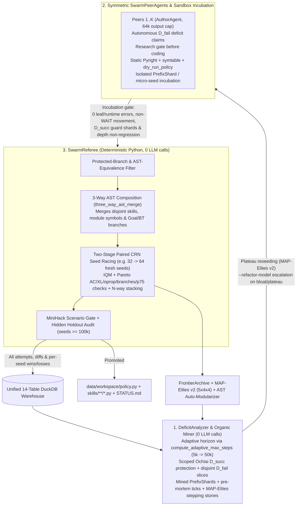

# LOX

**Autonomous empirical policy synthesis under one invariant: _Hard Code Nothing_.**

LOX is a neurosymbolic program-policy synthesis engine for long-horizon, partially observable permadeath environments—primarily **NetHack 3.6.6** via the **NetHack Learning Environment (NLE)**, with **MiniHack** scenario regression gates and pluggable **Craftax** benchmark support.

Instead of spending LLM tokens at every step or training monolithic neural policies on millions of shaped frames, LOX **separates synthesis from runtime execution**:

- **Between generations**, stateless LLM peer agents investigate DuckDB episode/tick telemetry, human ascension traces, C monster/object symbol tables, and an untruncated offline NetHackWiki + NetHack 3.6.6 Guidebook index to propose targeted edits to `policy.py` and modular `skills/` packages.
- **During evaluation**, policies compile into sandboxed, AST-instrumented Python modules backed by a native Rust PyO3 core (`lox_core`) and Numba kernels, executing directly against NLE C bindings at CPU speed under paired Common Random Numbers (CRN) racing and hidden holdout verification.

---

## Contents

1. [Core Architectural Invariant: Hard Code Nothing](#1-core-architectural-invariant-hard-code-nothing)
2. [Peer Swarm Architecture & E3 Hybrid Evolution](#2-peer-swarm-architecture--e3-hybrid-evolution)
3. [Option-A Policy Architecture, Language Runtime & Safety Gates](#3-option-a-policy-architecture-language-runtime--safety-gates)
4. [Environment Harness, Rust Core (`lox_core`), Scenarios & Craftax](#4-environment-harness-rust-core-lox_core-scenarios--craftax)
5. [DuckDB Telemetry Warehouse, QD Archives & Research Tools](#5-duckdb-telemetry-warehouse-qd-archives--research-tools)
6. [Single-Agent & Legacy Swarm Modes](#6-single-agent--legacy-swarm-modes)
7. [Repository Layout](#7-repository-layout)
8. [Installation, Verification & CLI Workflows](#8-installation-verification--cli-workflows)

---

## 1. Core Architectural Invariant: Hard Code Nothing

The harness, Rust extension, AST compiler, deficit analyzer, and tournament referee ([`lox/env/`](lox/env/), [`crates/lox-core/`](crates/lox-core/), [`lox/lang/`](lox/lang/), [`lox/engine/`](lox/engine/)) contain **zero** game heuristics, **zero** hardcoded monster/corpse/item lists, and **zero** hidden macro adapters. Domain knowledge is discovered empirically by synthesized policies inside `data/workspace/policy.py` and `data/workspace/skills/`.

| Layer | Responsibility | Key Files |
| :--- | :--- | :--- |
| **1-to-1 NLE Action Interface** | Exact mapping between policy yields and native NLE C keystrokes (`Action` enum, `key(ch)`, `seq(...)`, `repeat(...)`, `extcmd(...)`, `DIR_DELTAS`). | [`lox/env/actions.py`](lox/env/actions.py) |
| **Zero-Copy `GameState` & `WorldMemory`** | Exposes `blstats`, `BL_MASK_*`, `worn_oprop_mask`, 21×79 `chars`/`glyphs`/`colors`, per-floor `FloorMemory` (`passable_mask`, `safe_passable_mask`, `door_mask`, `level_exits`, under-hero occlusion clearing), and UI prompt state (`in_getobj_prompt`, `in_getdir_prompt`, `in_yn_prompt`, `in_text_prompt`, `in_menu`). | [`lox/env/state.py`](lox/env/state.py) |
| **NLE C Symbol Ground Truth** | Direct queries over NLE `permonst` (`level`, `speed`, `ac`, `mr`, `nutrition`, `cwt`, `conveys`, `resists`, `mflags1`–`3`) and `objclass` (`class`, `cost`, `weight`, `delay`, `prob`, `oprop`, `descr`). | [`lox/datasets/symbols.py`](lox/datasets/symbols.py) |
| **Safe Harness I/O** | Enforces `noautopickup` (`DEFAULT_NETHACKOPTIONS`), auto-clears `--More--` pagers, aborts invalid `seq(...)` chains in 0 turns (`seq_aborted`), prevents text/menu prompt hangs (`auto_esc_count`), and breaks zero-turn stalls (`stalled_zero_turn`). | [`lox/env/harness.py`](lox/env/harness.py) |

---

## 2. Peer Swarm Architecture & E3 Hybrid Evolution

The default synthesis pipeline ([`scripts/run_swarm.py`](scripts/run_swarm.py) with `--swarm-architecture peer`, orchestrated by [`SwarmCampaignOrchestrator`](lox/engine/swarm_orchestrator.py)) runs a symmetric peer-swarm and deterministic CRN tournament loop:



### How E3 Hybrid Evolution Works

1. **Data-Assigned Orthogonal Claims ([`swarm_deficits.py`](lox/author/swarm_deficits.py))**:
   - Without spending LLM calls, `DeficitAnalyzer` clusters failing episodes into orthogonal `DeficitCluster` targets (`slice_stalled`, `slice_unequipped_progression`, branch-specific stalls, or `bootstrap_survival` / `bootstrap_exploration` at Gen 1), scores functions via recency-weighted **Ochiai Good-Run Similarity** and **Liblit Failure Importance**, and extracts pre-mortem tick traces + `PrefixShard` checkpoints.
2. **Symmetric Peers with Isolated Workspaces ([`swarm_peer.py`](lox/author/swarm_peer.py), [`agent.py`](lox/author/agent.py))**:
   - Every `SwarmPeerAgent` shares identical full-stack access to `policy.py`, 1-level and 2-level `skills/` packages, DuckDB, C symbol tables, `TheoryDocumentStore`, and offline NetHackWiki.
   - Before coding, a **research gate** ensures the agent grounds its hypothesis in telemetry and domain facts (with tool-turn refunds so exploration does not starve coding turns).
   - Every candidate must pass static checks (`pyright` against dynamic `.pyi` stubs + CPython `symtable` + `#EVOLVE-BLOCK` bounds) and **isolated sandbox incubation** (`incubate_candidate`) before entering the tournament.
3. **Deterministic CRN Tournament & 3-Way AST Merging ([`swarm_referee.py`](lox/engine/swarm_referee.py), [`validator.py`](lox/lang/validator.py))**:
   - Candidates are deduplicated by AST equivalence and filtered against `D_succ` protected-branch clobbering.
   - Top AST/skill-disjoint survivors are combined via **`three_way_ast_merge`** into composite contenders, raced head-to-head against the current incumbent on fresh paired CRN seeds (Stage 1 `--race-seeds` → Stage 2 full `--seeds`), greedily N-way stacked when non-conflicting, and validated against an optional MiniHack `--scenario-gate` (`off`/`advisory`/`strict`) plus a **Hidden Holdout** (`seeds >= 100,000`).
4. **Telemetry & Horizon Discipline ([`orchestrator.py`](lox/engine/orchestrator.py), [`contracts.py`](lox/core/contracts.py))**:
   - `compute_adaptive_max_steps` scales episode horizons upward from `5,000` as promoted `p90_depth` grows.
   - Pre-gen and post-gen AST cohesion modularization ([`lox/lang/modularize.py`](lox/lang/modularize.py)) splits oversized files while asserting bit-identical `action_bytes` replay against NetHack seeds.

---

## 3. Option-A Policy Architecture, Language Runtime & Safety Gates

### Option-A Gen-0 Starter ([`lox/lang/starter.py`](lox/lang/starter.py))

When starting fresh, LOX bootstraps a minimal, domain-neutral **Option-A (`WorldState` + `GoalRunner`)** workspace with zero hardcoded gameplay heuristics:

- `data/workspace/policy.py` — thin turn loop (`WorldState.observe(state)` → `prompts.handle_prompts` → `survival.check_interrupt` → `combat.check_threat` → `GoalRunner.tick` → `goals.fallback_step`).
- `data/workspace/skills/world.py` — typed `WorldState` & per-`(dungeon_num, level_num)` `FloorCache` (zero-turn obstruction blacklisting + single-pass `passable_mask` / `safe_passable_mask` / `no_diag_mask` caching) plus `ws.domain(name, factory)` state isolation.
- `data/workspace/skills/prompts.py`, `survival/core.py`, `combat/core.py`, `navigation/core.py`, `goals/core.py` — minimal extensible scaffolds using 1-to-1 `Action` bindings and NLE C masks (`no_diag_mask`).

### Policy Language, Compiler & SSOT Bundling

- **Bundle Single Source of Truth ([`lox/lang/bundle.py`](lox/lang/bundle.py))**: Canonical parser/writer for XML `<policy_code>` / `<skill_code>` and `### skill:` responses, supporting both 1-level (`skills/prompts.py`) and 2-level (`skills/combat/core.py`) packages and AST skill-import dependency scanning.
- **Behavior Trees, StrategyStack & Contracts ([`bt.py`](lox/lang/bt.py), [`strategy.py`](lox/lang/strategy.py), [`contracts.py`](lox/lang/contracts.py))**:
  - `PrioritySelector`, `Sequence`, `MemorySequence`, `Inverter`, `ConditionLeaf`, `ActionLeaf` (generator coroutines, `min_commit`, `preempt_if`, `.halt()`), `@bt_leaf`, and floor-scoped `Blackboard`.
  - `StrategyStack` / `StrategyFrame` / `until` / `with_cleanup` for multi-turn plans with hazard preemption.
  - Typed runtime contracts (`GoalIntent`, `SafetyReport`, `WorldTracker`, `CapabilityScorer`, `ThreatEvaluator`) + `#EVOLVE-BLOCK:<name>` guard rails.
- **AST Validation, Sandboxing & Instrumentation ([`validator.py`](lox/lang/validator.py), [`compiler.py`](lox/lang/compiler.py), [`instrument.py`](lox/lang/instrument.py))**:
  - Generates `_lox_prelude.pyi` and runs `pyright` + CPython `symtable` checks pre-rollout.
  - Topological compilation of `skills/` + `macros.py` + `policy.py`, AST import/builtin sandboxing, loop watchdogs (`PolicyLoopError`), tunable parameter hooks (`self.param(...)`), and `<1 µs` per-function turn/call attribution via `ExecutionTracer`.

---

## 4. Environment Harness, Rust Core (`lox_core`), Scenarios & Craftax

- **Native Rust PyO3 Core ([`crates/lox-core/src/`](crates/lox-core/src/))**:
  - `lib.rs`, `path.rs`, `replay.rs`, `bt.rs`, `blackboard.rs` compile into the `lox_core` extension, exposing `PyBehaviorTree`, `PyBlackboard`, `fast_bfs_distance_grid`, `fast_astar_next_step`, `fast_replay_action_bytes`, `fast_update_floor_memory`, `fast_extract_exits`, `fast_trap_mask`, and `fast_unexplored_frontier_mask`, with Python/Numba fallbacks in [`lox/env/grid_utils.py`](lox/env/grid_utils.py).
- **MiniHack Scenarios & Prompt-Torture Suites ([`lox/env/benchmarks/nethack_scenarios.py`](lox/env/benchmarks/nethack_scenarios.py))**:
  - Procedural `.des` curriculum archetypes (locked doors, kicking, boulders, water/lava hazards, food/corpse mechanics, shops/altars, blind/confused/faint recovery) plus 4 NLE C prompt-torture suites (`--More--` collisions, text naming prompts, `[ynq]` traps, menu pagers).
- **Benchmark Abstraction ([`lox/env/base.py`](lox/env/base.py), [`lox/env/nethack/`](lox/env/nethack/adapter.py), [`lox/env/craftax/`](lox/env/craftax/adapter.py))**:
  - `EnvHarness` protocol and `BenchmarkAdapter` registry supporting both `nethack` (`NetHackAdapter`) and `craftax` (`CraftaxAdapter`) via `--benchmark`.
- **Multi-Core Worker Pool ([`lox/runner/pool.py`](lox/runner/pool.py))**:
  - Persistent worker pool with cancellation epochs, leaf-error traceback capture, CRN seed batching, and conditional function-trigger filtering.

---

## 5. DuckDB Telemetry Warehouse, QD Archives & Research Tools

### 14-Table DuckDB Schema ([`lox/db/schema.py`](lox/db/schema.py))

All campaign runs, rollouts, diagnostics, and human reference trajectories live in one DuckDB database (default: `data/lox.duckdb`):

| Group | Tables |
| :--- | :--- |
| **Evaluation & Traces** | `batches`, `runs`, `ticks`, `function_stats` (Ochiai & Liblit scores, `auto_esc_count`, `policy_exceptions`, `worn_oprop_count`, `dungeons_visited`, `unique_tiles`, `pct_wait`, `pct_search`) |
| **Lineage & Discoveries** | `policies`, `experiments`, `discoveries`, `tournament_attempts` (includes hidden holdout results & gained/lost seed sets) |
| **QD & Agent Memory** | `archive_policies` (5×4×4 MAP-Elites v2 cells), `theories` (`TheoryDocumentStore`), `synthesis_logs`, `llm_cost_rates` |
| **Human Reference Corpus** | `expert_runs`, `expert_ticks` (NAO ascensions + dumplogs/ttyrecs compiled into matching schema) |

### Agent Research Toolset ([`lox/author/tools.py`](lox/author/tools.py))

During synthesis turns, peers query the environment empirically through read-only inspection and validation tools:

- **Empirical Telemetry**: `query_db`, `query_theories`, `benchmark_expert_parity`
- **Domain Reference (Non-Spoiler)**: `query_wiki`, `read_wiki_article`, `query_monster`, `query_item`, `query_policy_docs`
- **Code & Architecture Navigation**: `architecture_map`, `blackboard_map`, `read_policy`, `read_skill`, `read_symbol`, `diff_policies`, `find_references`, `grep_skills`
- **Pre-Rollout Sandbox**: `dry_run_policy` (syntax, `pyright`, `symtable`, `TRIGGER_MISS`, and prompt-torture verification)

### Frontiers & Archives

- **Go-Explore Frontier Archive ([`lox/engine/frontier.py`](lox/engine/frontier.py))**: Stores byte-stream state checkpoints (`action_bytes`) on Dlvl 2+ and samples under-visited frontiers via `depth / sqrt(visit_count + 1)`.
- **MAP-Elites v2 ([`lox/engine/map_elites.py`](lox/engine/map_elites.py))**: Maintains a 5×4×4 diversity grid across `(depth_bin, caution_bin, resource_bin)` for plateau reseeding.
- **Offline Wiki ([`lox/datasets/wiki.py`](lox/datasets/wiki.py))**: SQLite FTS5 BM25 index (`data/wiki_index.db`) built from NetHackWiki XML dumps + NetHack 3.6.6 `Guidebook.html` ([`scripts/build_wiki_db.py`](scripts/build_wiki_db.py)).

---

## 6. Single-Agent & Legacy Swarm Modes

- **Single-Agent Campaign ([`scripts/run_lox.py`](scripts/run_lox.py), [`lox/engine/orchestrator.py`](lox/engine/orchestrator.py))**: Cycles `CREATE`, `WRITE`, and `REFACTOR` using [`ModeScheduler`](lox/engine/scheduler.py), pilot revisions (`--pilot-revisions 4`), **CRN-SPSA** parameter tuning ([`modes.py`](lox/engine/modes.py)), **Empirical Bernstein Confidence Sequences**, **One-Sided Paired Wilcoxon** tests, and **Sequential Futility Early Stopping** ([`hypothesis.py`](lox/engine/hypothesis.py)).
- **Legacy Hierarchical Swarm**: Earlier Critic/Meta/Worker topology remains selectable on [`scripts/run_swarm.py`](scripts/run_swarm.py) via `--swarm-architecture legacy`.

---

## 7. Repository Layout

```text
crates/lox-core/src/           # Rust PyO3 extension (BFS/A*, FloorMemory, frontier/exits/traps, replay, BT)
lox/
├── core/contracts.py          # Typed EpisodeRun, BatchEvaluation, CandidatePackage invariant guards
├── env/
│   ├── actions.py             # 1-to-1 NLE Action IntEnum, key(), seq(), repeat(), extcmd(), DIR_DELTAS
│   ├── base.py                # EnvHarness protocol & BenchmarkAdapter ABC
│   ├── state.py               # Lazy zero-copy GameState, NLE C masks, FloorMemory
│   ├── harness.py             # Direct C++ NLE harness & deterministic byte replay
│   ├── grid_utils.py          # Numba/Rust BFS & A* pathfinding kernels
│   ├── benchmarks/            # MiniHack procedural .des scenarios & NLE prompt-torture suites
│   ├── nethack/               # NetHackAdapter
│   └── craftax/               # Craftax actions, harness, state, adapter
├── lang/
│   ├── bt.py / strategy.py    # Behavior Tree primitives, Blackboard, StrategyStack
│   ├── contracts.py           # Cross-module typed contracts & #EVOLVE-BLOCK enforcement
│   ├── starter.py             # Bare Option-A Gen-0 WorldState + GoalRunner workspace generator
│   ├── bundle.py              # SSOT parser/writer/AST scanner for workspace packages
│   ├── validator.py           # AST sandbox, symtable check, pyright/.pyi stubs, 3-way AST merge
│   ├── modularize.py          # Bit-identical AST policy splitter & skill cohesion refactorer
│   ├── instrument.py          # <1 µs ExecutionTracer, loop watchdog, TunableParam hooks
│   ├── macros.py              # Optional persistent macro library helper
│   └── compiler.py            # Compiles workspace skills + macros + policy into PolicyRunner
├── db/
│   ├── schema.py              # 14-table DuckDB warehouse schema & migrations
│   ├── logger.py              # Thread-safe DuckDB batch/tick logger & tail sampling
│   ├── summarizer.py          # RLE trace digest, Z/IQR outlier detection, Ochiai/Liblit attribution
│   ├── shards.py              # PrefixShard extraction from recorded trajectories
│   └── theories.py            # DuckDB TheoryDocumentStore with BM25/tag search
├── datasets/
│   ├── wiki.py                # Offline NetHackWiki + Guidebook 3.6.6 SQLite FTS5 search
│   ├── symbols.py             # NLE C permonst & objclass table lookups
│   ├── download_experts.py    # NAO xlogfile/dumplog/ttyrec ingestion into expert_runs/expert_ticks
│   └── bootstrap_frontier.py  # Frontier checkpoint seeding helpers
├── runner/pool.py             # Multi-core persistent rollout & tournament worker pool
├── author/
│   ├── agent.py               # Stateless ReAct AuthorAgent (64k cap, OpenRouter/OpenAI/mock)
│   ├── prompts.py             # Cacheable static system prompts & workspace guidance
│   ├── tools.py               # AuthorToolRegistry (DB, Wiki, C symbols, code nav, dry_run_policy)
│   ├── swarm_deficits.py      # Orthogonal D_fail deficit slicing & D_succ protection
│   ├── swarm_peer.py          # Symmetric SwarmPeerAgent & isolated sandbox incubation
│   └── bt_eval.py / swarm_*   # Leaf diagnostics, meta-synthesis & legacy critic/worker modules
├── engine/
│   ├── swarm_orchestrator.py  # Peer Swarm Campaign Orchestrator
│   ├── swarm_referee.py       # Deterministic CRN tournament referee, 3-way AST merge & holdout audit
│   ├── orchestrator.py        # Single-agent CampaignOrchestrator & adaptive max_steps
│   ├── hypothesis.py          # Confidence sequences, paired Wilcoxon, IQM, futility early stop
│   ├── frontier.py            # Go-Explore byte-replay frontier archive
│   ├── map_elites.py          # 5x4x4 MAP-Elites v2 QD archive
│   ├── modes.py               # CRN-SPSA numeric parameter optimizer
│   └── scheduler.py           # Hybrid mode scheduler
└── ui/console.py              # ANSI terminal status & tournament tables
scripts/
├── run_swarm.py               # Primary Peer Swarm CLI entrypoint
├── run_lox.py                 # Single-agent synthesis CLI entrypoint
├── status_lox.py              # Read-only DuckDB campaign & cost dashboard
├── build_wiki_db.py           # Builds data/wiki_index.db from XML dump + Guidebook 3.6.6
├── download_experts.py        # Populates expert_runs / expert_ticks in DuckDB
├── calibrate_pilot.py         # Calibrates pilot budget from DuckDB history
├── modularize_policy.py       # Standalone AST policy modularizer CLI
├── reset_clean.py             # Resets campaign tables & workspace while preserving wiki/experts
└── build_core.sh              # Builds & installs lox-core via maturin --release
tests/                         # 185 automated unit & integration tests
```

---

## 8. Installation, Verification & CLI Workflows

### 1. Environment, Rust Core & Test Suite

```bash
uv sync
./scripts/build_core.sh          # compiles & installs lox_core (PyO3 release wheel)
uv run ruff check .
uv run ruff format --check .
uv run pytest -v                 # 185 tests
```

### 2. Build Offline Wiki & Human Expert Corpus (One-Time Setup)

```bash
# Downloads NetHackWiki XML + NetHack 3.6.6 Guidebook and builds data/wiki_index.db
uv run python scripts/build_wiki_db.py --download-xml

# Ingest real NAO human ascensions into DuckDB expert_runs / expert_ticks
uv run python scripts/download_experts.py --max-ascensions 1000 --fetch-dumplogs 25
```

### 3. Run Peer Swarm Synthesis Campaigns

Put `OPENROUTER_API_KEY="sk-or-v1-..."` in `.env` (or export it in your shell):

```bash
# Fresh campaign (--clean resets workspace & campaign DuckDB tables while keeping wiki & expert_runs)
uv run python scripts/run_swarm.py \
  --clean \
  --provider openrouter \
  --model z-ai/glm-5.3-flash:nitro \
  --refactor-model <optional-stronger-model> \
  --reasoning-effort medium \
  --workers 4 \
  --turns-per-worker 3 \
  --seeds 64 \
  --race-seeds 32 \
  --scenario-gate off \
  --generations 50

# Resume an existing campaign (omit --clean)
uv run python scripts/run_swarm.py \
  --provider openrouter \
  --model z-ai/glm-5.3-flash:nitro \
  --generations 50
```

> **Note:** On `scripts/run_swarm.py`, `--generations` defaults to `5` and `--scenario-gate` defaults to `off` (`off` / `advisory` / `strict`). Override `--generations` explicitly for long runs.

### 4. Offline Smoke Checks & Monitoring

```bash
# End-to-end mock swarm sanity check (zero LLM API calls)
uv run python scripts/run_swarm.py \
  --provider mock \
  --generations 2 \
  --workers 2 \
  --turns-per-worker 1 \
  --seeds 4 \
  --race-seeds 2

# Read-only campaign metrics, token spend & workspace summary
uv run python scripts/status_lox.py --since-hours 12
uv run python scripts/calibrate_pilot.py --db-path data/lox.duckdb
cat data/workspace/STATUS.md
```
