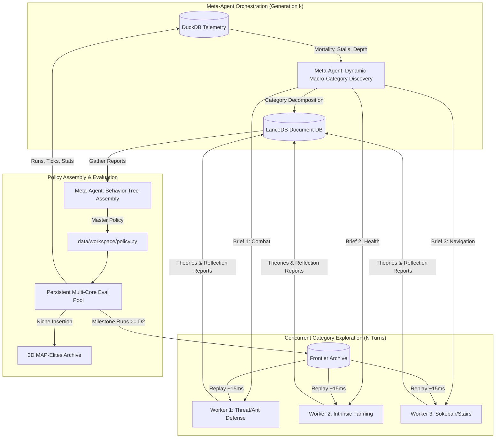

# LOX: Autonomous Empirical Policy Synthesis Engine

> **Architectural Motto:** *"Hard Code Nothing."*

`LOX` is an autonomous neuro-symbolic program synthesis engine that designs, verifies, attributes, and evolves executable Python control policies and modular skill packages from first principles. It is engineered for long-horizon, high-dimensional, stochastic environments with permadeath—primarily the **NetHack Learning Environment (NLE)**, with native support for the **Crafter / Craftax** survival benchmark.

Standard reinforcement learning requires billions of environment frames to train opaque neural weights, frequently stalling on NetHack's combinatorial item interactions, multi-step tactical puzzles, and sparse delayed rewards. Turn-by-turn LLM game agents pay prohibitive latency (1–3 seconds per action) and API costs ($50–$200 per game) that make statistical evaluation impossible.

`LOX` decouples reasoning speed from execution speed through a **Hierarchical Multi-Agent Swarm and Dual-Store Architecture**:

- **Execution Engine (C++ / Numba)**: Compiled Python 3.11+ Behavior Tree policies execute directly against native C environment harnesses at **120,000 to 285,000+ steps/second** across multi-core worker pools (`0` LLM tokens per action). The harness exposes lean zero-copy observation channels, auto-dismisses pagination (`--More--`), passes interactive decision prompts (`[yn]`, `[ynq]`, getlin) directly to policies with watchdog protection, and tracks zero-turn action stall telemetry (`state.turn_advanced`, `state.consecutive_stalls`).
- **Dynamic Swarm Synthesis Loop (Meta-Agent & Concurrent Category Workers)**: Rather than relying on static human roles, an empirical **Meta-Agent** dynamically analyzes DuckDB mortality and depth bottlenecks to discover emergent macro-categories per run. Specialized concurrent **Category Workers** run iterative exploration turns on **Go-Explore Frontier Checkpoints**, testing candidate code directly on replayed mid-game states in ~15ms, and logging theories into an embedded **LanceDB Document Store** (Tantivy BM25 FTS).
- **Hierarchical Behavior Tree Assembly**: The Meta-Agent integrates worker reflection reports into unified, modular Behavior Trees (`PrioritySelector`, `Sequence`, `ActionLeaf`, `ConditionLeaf`) communicating exclusively through a shared `Blackboard`.
- **Dual-Store Analytical Warehouse**: Unstructured agent theories, category decompositions, and reflection reports persist in **LanceDB**; structured episode telemetry, tail-sampled turn ticks, spectrum-based Ochiai/Liblit fault attributions, and exact USD LLM costs persist in **DuckDB**.

---

## Table of Contents

1. [Core Architectural Philosophy ("Hard Code Nothing")](#1-core-architectural-philosophy-hard-code-nothing)
2. [Hierarchical Multi-Agent Swarm Architecture](#2-hierarchical-multi-agent-swarm-architecture)
3. [Behavior Tree Policy Framework & Blackboard](#3-behavior-tree-policy-framework--blackboard)
4. [Dual-Store Architecture (LanceDB + DuckDB)](#4-dual-store-architecture-lancedb--duckdb)
5. [Go-Explore Frontier Checkpoints & 3D MAP-Elites Archive](#5-go-explore-frontier-checkpoints--3d-map-elites-archive)
6. [The Canonical Modification Modes](#6-the-canonical-modification-modes)
7. [Pilot Revision Gate & Negative-Delta Abort](#7-pilot-revision-gate--negative-delta-abort)
8. [Parameter-Free Sequential Hypothesis Testing](#8-parameter-free-sequential-hypothesis-testing)
9. [Automated LLM Token & USD Cost Accounting](#9-automated-llm-token--usd-cost-accounting)
10. [Repository Structure](#10-repository-structure)
11. [Quickstart & CLI Usage](#11-quickstart--cli-usage)
12. [References & Citations](#12-references--citations)

---

## 1. Core Architectural Philosophy ("Hard Code Nothing")

Most game-playing agents depend on human-engineered domain scaffolding: hardcoded monster threat tiers, pre-scripted nutrition tables, built-in pathfinding macros, or hand-tuned phase guides. While these heuristics ease progress through early levels, they create an impenetrable barrier once the agent encounters un-scripted mechanics.

`LOX` strictly enforces a separation between the **Architect** (the domain-agnostic execution and evaluation engine) and the **Author** (the self-synthesizing policy and modular skill codebase):

1. **Zero Domain Heuristics in the Harness ([`lox/env/`](lox/env/))**:
   - The harness contains **zero** monster, corpse, or item lists, and **zero** hidden macro adapters.
   - It provides a **1-to-1 connection** between policy yields and native environment actions ([`Action`](lox/env/actions.py) / [`CraftaxAction`](lox/env/craftax/actions.py), [`key(ch)`](lox/env/actions.py) raw ASCII characters, and [`seq(...)`](lox/env/actions.py) multi-keystroke action sequences).
   - Game state is exposed lazily via [`GameState`](lox/env/state.py): 27 `blstats` fields, `BL_MASK_*` status bitmasks, 21×79 screen grids (`glyphs`, `chars`, `colors`, `specials`), inventory items, and pre-indexed C symbol table queries over `nle.nethack.permonst` (`state.mon_info(y, x)`) and `nle.nethack.objclass` (`state.obj_info(glyph)`), paired with Numba-JIT spatial topology primitives in [`lox/env/grid_utils.py`](lox/env/grid_utils.py).
   - **Lean Observation Channels**: Bypasses redundant C-level rasterization buffers (`screen_descriptions`, `misc`) by default to reach **285,000+ steps/second** while retaining complete `tty_*` terminal line access.
   - **Interactive Prompt Passthrough**: Decouples pagination (`--More--`, auto-cleared with `SPACE`) from true decision prompts (`in_yn_function`, `in_getlin`), allowing policies to respond interactively across steps with a 3-step watchdog.
   - **Zero-Turn Action Stall Guard**: Automatically tracks `state.turn_advanced` and `state.consecutive_stalls`. Runaway action loops (e.g. repeatedly bumping into peaceful monsters or overweight containers) are truncated after 100 consecutive zero-turn steps with reason `stalled_zero_turn`.

2. **Near-Full Python 3.11+ Policy Language & Behavior Trees ([`lox/lang/`](lox/lang/))**:
   - The Author Agent writes standard Python 3.11+ Behavior Trees in `data/workspace/policy.py` and modular skill packages in `data/workspace/skills/`: classes, stateful generator coroutines (`yield` / `yield from`), `match/case` pattern matching, comprehensions, `@dataclass`, closures, and safe standard library modules (`math`, `collections`, `heapq`, `itertools`, `functools`, `re`, `numpy`, `random`, `bisect`, `copy`).
   - Compile-time AST instrumentation ([`PolicyInstrumentTransformer`](lox/lang/instrument.py) and [`ExecutionTracer`](lox/lang/instrument.py)) injects `<1 µs` per-function call tracking, per-function turn attribution, zero-yield loop protection ([`PolicyLoopError`](lox/lang/instrument.py)), and parameter hooks (`self.param(name, default, min_val, max_val)`).
   - Automatic naming prompt fallback: exposes `state.in_text_prompt` / `state.in_naming_prompt` directly to policy state and features a safety fallback auto-`ESC` in the execution runner to prevent unhandled text prompts (e.g. `Call a scroll: `) from stalling policies.

---

## 2. Hierarchical Multi-Agent Swarm Architecture

`LOX` replaces monolithic single-agent prompting with an asynchronous, hierarchical multi-agent swarm governed by empirical bottleneck discovery:



### Swarm Lifecycle

1. **Dynamic Macro-Category Discovery**:
   - At the beginning of generation $k$, the Meta-Agent queries DuckDB's latest mortality telemetry (`end_reason`, `death_message`), depth distribution, prompt dismissals (`auto_esc_count`), and blunders (`starved_with_food`, `died_unarmored`).
   - Rather than static human roles, categories emerge dynamically matching the active frontier (e.g. early vermin kiting on Dlvl 1–2 vs. soldier ant poison defense & Sokoban boulder navigation on Dlvl 4–6).
   - The decomposition plan is persisted into LanceDB as a `CATEGORY_DECOMPOSITION` document.
2. **Concurrent Category Worker Exploration**:
   - $M$ specialized workers execute in parallel.
   - For $N$ exploration turns, each worker queries C symbol tables (`query_monster`, `query_item`) and DuckDB, formulates hypotheses, synthesizes candidate subtrees, and evaluates them directly on replayed frontier checkpoints in ~15ms.
   - Intermediate theories and empirical score deltas are saved into LanceDB. At the end of $N$ turns, each worker writes a structured `REFLECTION_REPORT`.
3. **Behavior Tree Master Policy Assembly**:
   - The Meta-Agent retrieves worker reflection reports from LanceDB and assembles verified subtrees into a master Behavior Tree `PrioritySelector` with strict Blackboard communication.
   - Validates Python AST and writes the policy to `data/workspace/policy.py`.
4. **Full Multi-Core Rollout & Dual-Store Logging**:
   - The master policy is evaluated across seeds on the persistent worker pool.
   - Runs, tail-sampled ticks, and Ochiai/Liblit fault attributions are logged to DuckDB.
   - New milestone trajectories (depth $\ge 2$) are automatically added to the Go-Explore Frontier Archive.

---

## 3. Behavior Tree Policy Framework & Blackboard

`LOX` policies are structured as modular **Behavior Trees** ([`lox/lang/bt.py`](lox/lang/bt.py)), eliminating fragile monolithic `if/elif/else` spaghetti:

```python
# Master Behavior Tree Policy - Synthesized by Meta-Agent (Gen k)
import numpy as np
from lox.env.actions import Action, DIR_DELTAS, seq
from lox.lang.bt import BehaviorTree, PrioritySelector, Sequence, ActionLeaf, ConditionLeaf, Blackboard

class Policy:
    def __init__(self):
        self.blackboard = Blackboard()

        # Priority 1: Interactive Prompts & --More-- Pagination
        def dialog_action(state):
            if getattr(state, "waiting_for_space", False):
                return Action.SPACE
            if getattr(state, "in_text_prompt", False) or getattr(state, "in_yn_prompt", False):
                return Action.ESC
            return None
        self.node_dialog = ActionLeaf(dialog_action, name="DialogLeaf")

        # Priority 2: Tactical Threat & Melee Combat
        def threat_action(state, bb):
            if hasattr(state, "adjacent_monsters"):
                hostiles = state.adjacent_monsters(exclude_pets=True)
                if hostiles:
                    m = hostiles[0]
                    bb.set_var("last_target", (m.y, m.x))
                    return DIR_DELTAS.get((m.y - state.y, m.x - state.x), Action.WAIT)
            return None
        self.node_threat = ActionLeaf(threat_action, name="ThreatLeaf")

        # Priority 3: Spatial Exploration & Stair Descent
        def navigation_action(state, bb):
            if state.char_at(state.y, state.x) == ">":
                return Action.DOWN
            stairs = np.argwhere(state.chars == ord(">"))
            if len(stairs) > 0:
                ty, tx = stairs[0]
                dy = int(np.sign(ty - state.y))
                dx = int(np.sign(tx - state.x))
                return DIR_DELTAS.get((dy, dx), Action.SEARCH)
            return Action.SEARCH
        self.node_navigation = ActionLeaf(navigation_action, name="NavigationLeaf")

        # Assemble Master Priority Selector
        root = PrioritySelector([
            self.node_dialog,
            self.node_threat,
            self.node_navigation,
        ], name="MasterSelector")

        self.tree = BehaviorTree(root=root, blackboard=self.blackboard)

    def step(self, state):
        return self.tree.tick(state)
```

### Invariants:
- **Zero Hidden Mutations**: Nodes must NOT mutate arbitrary `self.*` attributes on `Policy`. Inter-node state is communicated strictly through `blackboard.get_var(key)` / `blackboard.set_var(key, val)`.
- **Status Enum Flow**: Leaves return `NodeStatus.SUCCESS`, `NodeStatus.FAILURE`, or `NodeStatus.RUNNING` alongside optional actions, allowing sequences to manage multi-step actions cleanly.

---

## 4. Dual-Store Architecture (LanceDB + DuckDB)

`LOX` separates unstructured scientific reasoning from high-throughput numerical telemetry using a dual-store model:

| Dimension | **LanceDB Document Store** ([`lox/db/theories.py`](lox/db/theories.py)) | **DuckDB Analytical Warehouse** ([`lox/db/schema.py`](lox/db/schema.py)) |
| :--- | :--- | :--- |
| **Primary Data** | Unstructured hypotheses, qualitative discoveries, category plans, and reflection reports. | Structured episode runs, tail-sampled ticks, function call attribution, and exact LLM token/cost rates. |
| **Search Engine** | Tantivy BM25 Full-Text Search (keyword indexing over markdown contents). | Vectorized SQL queries, analytical window functions, and columnar scans. |
| **Storage Engine** | Apache Arrow native columnar tables (`theories.lance`). | DuckDB single-file database (`data/lox.duckdb`). |
| **Agent Access** | `query_theories(query, doc_type)` | `query_db(sql)` |

---

## 5. Go-Explore Frontier Checkpoints & 3D MAP-Elites Archive

### 5.1 Go-Explore Frontier Checkpoint Archive ([`lox/engine/frontier.py`](lox/engine/frontier.py))

Evaluating deep-game combat (e.g. Dlvl 4 soldier ants, Sokoban boulder puzzles, or Castle drawbridges) from turn 0 wastes thousands of steps on early floor exploration. LOX archives verified milestone trajectories directly as raw action byte sequences:
- **Instant Fast-Forward**: Harnesses reset with the recorded seed and replay action bytes in **~10–20 ms**, positioning the agent directly into mid-game tactical situations.
- **Checkpoints Directory (`data/frontier/`)**: Persists `.json` metadata and `.bytes` raw sequences across Dlvl 2, 3, 4, 5, and beyond.
- **Bootstrap Engine ([`lox/datasets/bootstrap_frontier.py`](lox/datasets/bootstrap_frontier.py))**: Extracts high-depth milestones directly from recorded historical runs and expert human ascensions.

### 5.2 3D MAP-Elites Quality-Diversity Archive ([`lox/engine/map_elites.py`](lox/engine/map_elites.py))

To prevent premature convergence on local optima, `LOX` maintains an **80-cell behavioral niche archive** across three orthogonal phenotypic dimensions:

1. **Depth Progression (5 Bins)**: Dlvl 1, Dlvl 2, Dlvl 3, Dlvl 4, Dlvl 5+.
2. **Caution & Deliberation (4 Bins)**: Proportion of search and wait actions (`[0, 0.10)`, `[0.10, 0.25)`, `[0.25, 0.50)`, `[0.50, 1.0]`).
3. **Resource Mastery (4 Bins)**: Score density per turn (`[0, 0.20)`, `[0.20, 0.50)`, `[0.50, 1.0)`, `[1.0, inf)`).

Each niche retains the highest-fitness policy discovered for that behavioral profile, providing diverse stepping stones for future mutations.

---

## 6. The Canonical Modification Modes

Mode scheduling is governed by [`ModeScheduler`](lox/engine/scheduler.py):

| Canonical Mode | Episode Budget | Verification Gate | Purpose & Constraints |
|:---|:---|:---|:---|
| **`CREATE`** | `250` episodes | 30-episode live smoke test | Synthesizes `class Policy` from scratch on Generation 0 (or when starting fresh). Writes full class definition with core survival/navigation loops. |
| **`WRITE`** | `150` triggered episodes + `40` shards | 4 × 30-episode pilot revision loop | The iterative workhorse mode. Surgically adds or modifies targeted methods on `Policy`. **Mutation Scope Guard:** Strictly limited to at most 2 functions (1 primary method + 1 caller/helper) to isolate causality and prevent cross-subsystem regressions. Untriggered episodes (`triggered == False`) are discarded. |
| **`REFACTOR`** | `200` episodes | Behavioral preservation gate ($\bar{d} \ge -0.015$, $\text{losses} \le \text{wins} + 5$) | Triggered automatically when `policy.py` reaches $\ge 450$ lines (every $\ge 4$ generations). Modularizes monolithic methods into external skill packages under `data/workspace/skills/`. Multi-function restructuring is permitted. |

---

## 7. Pilot Revision Gate & Negative-Delta Abort

Before any candidate policy is allowed to run a full 150-seed rollout, it must pass through the **Execution-Guided Pilot Gate** inside `dry_run_policy`:

1. **Paired Seed Pilot Evaluation**: Evaluates the candidate against the active champion across 30 paired baseline episodes in ~0.8 seconds.
2. **Empirical Revision Budget (`--pilot-revisions 4`)**: Capped at 4 revision attempts. Empirical calibration shows attempts $\ge 5$ yield 0.0% promotion transfer; capping at 4 eliminates wasted LLM calls.
3. **Negative-Delta Rollout Abort**: When `--pilot-fallback best` is enabled, candidate promotion to full rollout is permitted **if and only if its pilot delta is non-negative ($\Delta \ge 0.0$)**. Known regressive candidates ($\Delta < 0.0$) abort the generation immediately (`PILOT_GATE_ABORT`), saving compute.
4. **Mutation Scope Intercept**: In `WRITE` mode, modifying $>2$ functions returns `MUTATION_SCOPE_ERROR` in 0ms, instructing the agent to narrow its patch before burning pilot runs.

---

## 8. Parameter-Free Sequential Hypothesis Testing

The Author Agent never guesses numerical effect sizes. It emits a structured qualitative YAML hypothesis before its Python code:

```yaml
mode: WRITE
target_functions:
  - descend_or_explore
binding_constraint: "68% of Dlvl 1 timeouts occur when the hero steps onto '>' (stairs down) and immediately steps off because state.chars[y, x] is '@' rather than '>'."
verified_c_rule: "Descending stairs requires yielding Action.DOWN ('>') while standing on the staircase down tile (state.is_on_stairs_down or state.stairs_down_pos == state.pos)."
skill_name: "Immediate Stair Descent & Frontier Navigation"
precondition: "No adjacent high-threat monsters; stairs down '>' known or visible."
state_persistence: "state.mem.remembered_chars and self.explore_target"
postcondition: "Increments state.depth by descending '>' upon reaching stairs_down_pos."
observation_from_db: "Outlier runs reaching Dlvl 4+ execute Action.DOWN within 1 turn of reaching stairs_down_pos."
mechanism: "Check state.is_on_stairs_down before pathfinding so the policy yields Action.DOWN immediately when standing on '>'."
```

Candidate policies are evaluated on paired seeds against the active baseline using objective statistical criteria in [`lox/engine/hypothesis.py`](lox/engine/hypothesis.py):
1. **Sequential Futility Early Stopping**: If after $n \ge 60$ paired triggered seeds the 95% Empirical Bernstein Confidence Sequence upper bound satisfies $U_n \le 0.0$, rollout halts immediately to preserve compute.
2. **Positive Mean Progression Delta**: $\bar{d} \ge -0.005$ and strictly more improved seeds than regressed seeds ($\text{wins} > \text{losses}$).
3. **Decisive-Pair Statistical Significance**: Either the 95% Confidence Sequence lower bound $L_N > 0.0$, the one-sided Paired Wilcoxon Signed-Rank test satisfies $p < 0.05$, or the decisive subset ($|\Delta| > 10^{-6}$) achieves positive significance ($L_{dec} > 0.0$ or $\text{wins} \ge 2 \times \text{losses}$ with $\bar{d}_{dec} \ge 0.15$). This eliminates the *tie-dilution trap* where 60–80% trajectory ties on mature baselines crush statistical power for modular patches.

---

## 9. Automated LLM Token & USD Cost Accounting

`LOX` automatically tracks every token generated across the Author Agent, Meta-Agent, and Category Workers directly in DuckDB:

- **Per-Model Rate Table (`llm_cost_rates`)**: Automatically initializes per-million token pricing for OpenRouter, DeepSeek, Anthropic, OpenAI, and Gemini models.
- **Granular Token Logging (`synthesis_logs`)**: Records `prompt_tokens`, `completion_tokens`, `reasoning_tokens`, `agent_role`, and exact `cost_usd` per LLM interaction.
- **Batch Aggregation (`batches`)**: Records `total_cost_usd` and `total_llm_tokens` directly in generation metadata for complete cost attribution.

---

## 10. Repository Structure

```text
lox/
├── core/
│   └── contracts.py        # Typed EpisodeRun, BatchEvaluation, CandidatePackage contracts
├── env/
│   ├── actions.py          # 1-to-1 Action IntEnum, key(), seq(), DIR_DELTAS
│   ├── base.py             # BenchmarkAdapter protocol & registry
│   ├── craftax/            # CraftaxAdapter, 17 actions, 22-achievement ruleset
│   ├── grid_utils.py       # Numba-JIT BFS, A*, room flood-fill, chokepoints, LOS raycasting
│   ├── harness.py          # Direct C++ NLE harness, lean observations, byte replay & watchdog
│   ├── nethack/            # NetHackAdapter & composite progression index
│   └── state.py            # Lazy zero-copy GameState, WorldMemory, C struct LUTs, stall tracking
├── lang/
│   ├── bt.py               # Modular Behavior Tree framework (PrioritySelector, Sequence, ActionLeaf, Blackboard)
│   ├── compiler.py         # Compiles policy.py + skills into PolicyRunner instances
│   ├── instrument.py       # ExecutionTracer, TunableParam, PolicyInstrumentTransformer
│   ├── macros.py           # Persistent MacroLibrary manager
│   └── validator.py        # Python 3.11+ AST sandbox validator, function splicer & contract linter
├── db/
│   ├── logger.py           # High-throughput DuckDB batch logger with tail-based tick sampling
│   ├── schema.py           # 8-table DuckDB analytical schema, LLM cost rates & thread-safe init
│   ├── shards.py           # 3-tier PrefixShard extractor (Frontier, Mid-Band, Foundation)
│   ├── summarizer.py       # RLE timeline compressor, stall analyzer, Ochiai/Liblit attribution
│   └── theories.py         # LanceDB embedded document store with Tantivy BM25 FTS index
├── datasets/
│   ├── bootstrap_frontier.py # Bootstraps multi-depth frontier checkpoints from DuckDB into data/frontier/
│   ├── download_experts.py   # Downloads Hardfought NetHack 3.6/3.7 human ascensions into expert_runs/ticks
│   ├── symbols.py            # Pre-indexed C symbol tables over nle.nethack.permonst & objclass
│   └── wiki.py               # Offline NetHack 3.6.6 Wiki SQLite FTS5 BM25 search engine
├── runner/
│   └── pool.py             # Persistent multi-core worker pool & conditional trigger filter
├── author/
│   ├── agent.py            # Stateless ReAct AuthorAgent with compiler-in-the-loop self-repair
│   ├── prompts.py          # Epistemic System Prompt, dynamic User Prompt & Contrastive Digest
│   ├── swarm_meta.py       # Meta-Agent dynamic macro-category discoverer & Behavior Tree assembler
│   ├── swarm_worker.py     # Concurrent Category Worker agent with empirical checkpoint evaluation
│   └── tools.py            # AuthorToolRegistry: query_db, query_wiki, query_policy_docs, dry_run_policy
├── engine/
│   ├── frontier.py         # Go-Explore Frontier Checkpoint Archive & fast replay (~15ms)
│   ├── hypothesis.py       # Empirical Bernstein Confidence Sequences, Wilcoxon Signed-Rank, Futility Early Stopping
│   ├── map_elites.py       # 80-cell 3D Quality-Diversity MAP-Elites Behavioral Archive
│   ├── modes.py            # ModeConfig & canonical mode configurations
│   ├── orchestrator.py     # Single-agent CampaignOrchestrator, Adaptive Horizon & Status Reporter
│   ├── scheduler.py        # ModeScheduler (CREATE, WRITE, REFACTOR)
│   └── swarm_orchestrator.py # Hierarchical Multi-Agent Swarm Campaign Orchestrator
└── ui/
    └── console.py          # Compact ANSI console UI with single-line progress & summary tables
scripts/
├── build_strategy_wiki.py  # Indexes high-level NetHack strategy & mechanics articles into wiki_index.db
├── build_wiki_db.py        # Builds data/wiki_index.db from data/nethackwikidata.json
├── calibrate_pilot.py      # Calibrates pilot revision budget and evaluates transfer rates from DuckDB
├── download_experts.py     # Compiles 1,000+ human ascensions into expert_runs and expert_ticks
├── reset_clean.py          # Resets campaign to Gen 0 while preserving expert corpus & wiki
├── run_lox.py              # Single-agent synthesis campaign CLI entrypoint
├── run_swarm.py            # Hierarchical Multi-Agent Swarm campaign CLI entrypoint
└── status_lox.py           # Morning/evening read-only check-in dashboard CLI
```

---

## 11. Quickstart & CLI Usage

### 1. Installation, Linting & Automated Tests
LOX uses [`uv`](https://docs.astral.sh/uv/) for high-speed package and dependency management:
```bash
# Clone the repository
git clone git@github.com:saejin-moon/lox.git
cd lox

# Install dependencies into .venv
uv sync

# Run linter, formatter checks, and full test suite (107 automated tests)
uv run ruff check --fix .
uv run ruff format .
uv run pytest -v
```

### 2. Ingest 1,000+ Human Ascensions & Build Offline Wiki
```bash
# Ingest 1,000+ real human ascensions from Hardfought into DuckDB
uv run python scripts/download_experts.py --max-ascensions 1000 --fetch-dumplogs 25

# Bootstrap multi-depth frontier checkpoints (Dlvl 2, 3, 4, 5)
uv run python lox/datasets/bootstrap_frontier.py --db-path data/lox.duckdb

# Build offline NetHack 3.6.6 Wiki FTS5 search engine
uv run python scripts/build_wiki_db.py
uv run python scripts/build_strategy_wiki.py
```

### 3. Launch an Autonomous Hierarchical Swarm Campaign
```bash
export OPENROUTER_API_KEY="sk-or-v1-..."

# Launch a 10-generation Swarm Campaign with 4 concurrent category workers:
uv run python scripts/run_swarm.py \
  --generations 10 \
  --workers 4 \
  --turns-per-worker 3 \
  --seeds 8 \
  --provider openrouter \
  --model z-ai/glm-5.3-flash:nitro
```

### 4. Fast Local Smoke Testing (Mock Provider)
```bash
# Verify complete end-to-end swarm loop in ~3.5 seconds
uv run python scripts/run_swarm.py \
  --provider mock \
  --generations 2 \
  --workers 3 \
  --turns-per-worker 1 \
  --seeds 2
```

### 5. Monitor Active Campaigns
```bash
# Read-only check-in CLI
uv run python scripts/status_lox.py --since-hours 12

# Calibrate pilot revision budget from empirical DuckDB history
uv run python scripts/calibrate_pilot.py --db-path data/lox.duckdb

# Live status dashboard
cat data/workspace/STATUS.md

# Monitor errors (if any)
tail -f data/workspace/campaign_errors.log
```

---

## 12. References & Citations

### Environments & Long-Horizon Benchmarks
1. **Küttler, H., Nardelli, N., Miller, A. H., Raileanu, R., Selvatici, M., Grefenstette, E., & Rocktäschel, T.** (2020). *The NetHack Learning Environment.* Advances in Neural Information Processing Systems (NeurIPS), 33, 7671-7684.
2. **Hambro, E., Mohanty, S., Babaev, D., Byeon, M., Chakraborty, D., Grefenstette, E., Jiang, M., Jo, J., Kanervisto, A., Kim, J., et al.** (2022). *Insights from the NeurIPS 2021 NetHack Challenge.* Proceedings of Machine Learning Research (PMLR), 176, 41-52.
3. **Hafner, D.** (2022). *Benchmarking the Spectrum of Agent Capabilities (Crafter).* International Conference on Learning Representations (ICLR).
4. **Matthews, M., Beukman, M., Ellis, B., Samvelyan, M., Jackson, M., Coward, S., & Foerster, J.** (2024). *Craftax: A Lightning-Fast Benchmark for Open-Ended Reinforcement Learning.* International Conference on Machine Learning (ICML).

### Evolutionary Program Synthesis, Quality-Diversity & Library Learning
5. **Romera-Paredes, B., Barekatain, M., Novikov, A., Balog, M., Kumar, M. P., Dupont, E., Ruiz, F. J. R., Ellenberg, J. S., Wang, P., Fawzi, O., Kohli, P., & Fawzi, A.** (2024). *Mathematical discoveries from program search with large language models (FunSearch).* Nature, 625, 468-475.
6. **Novikov, A., Vu, N., Eisenberger, M., Dupont, E., Huang, P.-S., Wagner, A. Z., Shirobokov, S., Kozlovskii, B., Ruiz, F. J. R., Mehrabian, A., Kumar, M. P., See, A., Chaudhuri, S., Holland, G., Davies, A., Nowozin, S., Kohli, P., & Balog, M.** (2025). *AlphaEvolve: A coding agent for scientific and algorithmic discovery.* Google DeepMind Technical Report (and open-source reference architecture `rom1nux/alpha-evolve`).
7. **Ellis, K., Wong, C., Nye, M., Sablé-Meyer, M., Morales, L., Hewitt, L., Cary, L., Solar-Lezama, A., & Tenenbaum, J. B.** (2021). *DreamCoder: Bootstrapping inductive program synthesis with wake-sleep library learning.* ACM SIGPLAN Conference on Programming Language Design and Implementation (PLDI), 835-850.
8. **Wang, G., Xie, Y., Jiang, Y., Mandlekar, A., Xiao, C., Zhu, Y., Fan, L., & Anandkumar, A.** (2023). *Voyager: An Open-Ended Embodied Agent with Large Language Models.* Transactions on Machine Learning Research (TMLR).
9. **Mouret, J.-B., & Clune, J.** (2015). *Illuminating search spaces by mapping elites (MAP-Elites).* arXiv:1504.04909.

### Epistemic World Modeling, Contrastive Reflection & Execution-Guided Synthesis
10. **Tang, H., Key, D., & Ellis, K.** (2024). *WorldCoder, a Model-Based LLM Agent: Building World Models by Writing Code and Interacting with the Environment.* Advances in Neural Information Processing Systems (NeurIPS), 37.
11. **Wu, Y., Prabhumoye, S., Min, S. Y., Bisk, Y., Salakhutdinov, R., Azaria, A., Mitchell, T., & Li, Y.** (2023). *SPRING: Studying the Paper and Reasoning to Play Games.* Advances in Neural Information Processing Systems (NeurIPS), 36.
12. **Bundy, A., et al.** (2026). *Automated Epistemic Theory Revision and Failure-Driven World Model Repair in Symbolic Agents.* Artificial Intelligence.
13. **Shinn, N., Cassano, F., Gopinath, A., Narasimhan, K., & Yao, S.** (2023). *Reflexion: Language Agents with Verbal Reinforcement Learning.* Advances in Neural Information Processing Systems (NeurIPS), 36.
14. **Zhao, A., Huang, D., Xu, Q., Lin, M., Liu, Y.-J., & Huang, G.** (2024). *ExpeL: LLM Agents Are Experiential Learners.* Proceedings of the AAAI Conference on Artificial Intelligence, 38(17), 19632-19642.
15. **Ridnik, T., Kredo, D., & Friedman, I.** (2024). *Code Generation with AlphaCodium: From Prompt Engineering to Flow Engineering.* arXiv:2401.08500.
16. **Chen, X., Lin, M., Schärli, N., & Zhou, D.** (2023). *Teaching Large Language Models to Self-Debug.* International Conference on Learning Representations (ICLR).
17. **Loi, M., et al.** (2026). *Contrastive Evaluation-Driven Program Synthesis for Long-Horizon Decision Making.* International Conference on Learning Representations (ICLR).

### Exploration, Subsumption Control, Behavior Trees & Multi-Agent Swarms
18. **Ecoffet, A., Huizinga, J., Lehman, J., Stanley, K. O., & Clune, J.** (2021). *First return, then explore (Go-Explore).* Nature, 590, 580-586.
19. **Brooks, R. A.** (1986). *A robust layered control system for a mobile robot (Subsumption Architecture).* IEEE Journal on Robotics and Automation, 2(1), 14-23.
20. **Colledanchise, M., & Ögren, P.** (2018). *Behavior Trees in Robotics and AI: An Introduction.* CRC Press.
21. **Du, Y., Li, S., Torralba, A., Tenenbaum, J. B., & Mordatch, I.** (2023). *Improving Factuality and Reasoning in Language Models through Multiagent Debate.* arXiv:2305.14325.
22. **Sutton, R. S., Precup, D., & Singh, S.** (1999). *Between MDPs and semi-MDPs: A framework for temporal abstraction in reinforcement learning (Options Framework).* Artificial Intelligence, 112(1-2), 181-211.
23. **Böhme, M., Pham, V.-T., & Roychoudhury, A.** (2017). *Coverage-Based Greybox Fuzzing as Markov Chain (AFLFast).* IEEE Transactions on Software Engineering, 45(5), 489-506.

### Spectrum-Based Attribution, Stochastic Optimization & Sequential Hypothesis Testing
24. **Abreu, R., Zoeteweij, P., & van Gemund, A. J. C.** (2007). *On the Accuracy of Spectrum-based Fault Localization (Ochiai).* Testing: Academic and Industrial Conference Practice and Research Techniques (TAICPART-MUTATION), 89-98.
25. **Liblit, B., Naik, M., Zheng, A. X., Aiken, A., & Jordan, M I.** (2005). *Scalable statistical bug isolation.* ACM SIGPLAN Conference on Programming Language Design and Implementation (PLDI), 15-26.
26. **Spall, J. C.** (1992). *Multivariate stochastic approximation using a simultaneous perturbation gradient approximation (SPSA).* IEEE Transactions on Automatic Control, 37(3), 332-341.
27. **Kleijnen, J. P. C.** (2009). *Design and Analysis of Simulation Experiments (Common Random Numbers).* Springer Series in Statistics.
28. **Howard, S. R., Ramdas, A., McAuliffe, J., & Sekhon, J.** (2021). *Time-uniform, nonparametric, nonasymptotic confidence sequences.* The Annals of Statistics, 49(2), 1055-1080.
29. **Waudby-Smith, I., & Ramdas, A.** (2024). *Estimating means of bounded random variables by betting.* Journal of the Royal Statistical Society Series B: Statistical Methodology, 86(1), 1-27.
