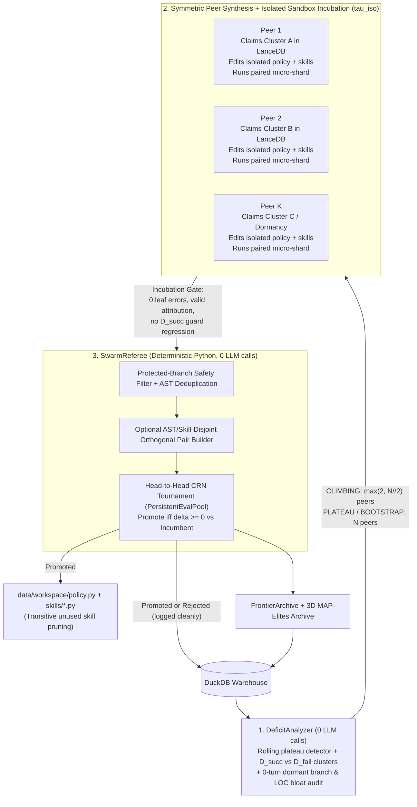

# LOX

**Autonomous empirical policy synthesis under one invariant: _Hard Code Nothing_.**

LOX is an empirical program synthesis engine that designs, compiles, instruments, benchmarks, and evolves executable Python 3.11+ Behavior Tree policies and modular skill packages for long-horizon stochastic environments with permadeath—primarily the **NetHack Learning Environment (NLE)**, with benchmark adapter support for **Craftax**.

Two paradigms usually fail on NetHack for opposite reasons:
- **End-to-end RL** requires massive frame budgets to shape opaque weights against sparse, delayed rewards and combinatorial item/monster mechanics.
- **Turn-by-turn LLM agents** pay 1–3 seconds and API tokens on every single keystroke, making large-sample paired evaluation financially and temporally infeasible.

LOX resolves this by **decoupling offline reasoning from runtime execution**: LLM agents only run *between* batches to inspect SQL telemetry, episode summaries, C engine symbol tables, and wiki mechanics, synthesizing compiled Behavior Trees and Python skills that execute directly against the C simulator with zero LLM calls per turn.

---

## Table of Contents

1. [Core Principle: Hard Code Nothing](#1-core-principle-hard-code-nothing)
2. [Democratized Peer Swarm Architecture](#2-democratized-peer-swarm-architecture)
3. [Execution Pipeline: AST Instrumentation, Behavior Trees & Rust Core](#3-execution-pipeline-ast-instrumentation-behavior-trees--rust-core)
4. [Telemetry Summarization, Confinement Detection & Spectrum Attribution](#4-telemetry-summarization-confinement-detection--spectrum-attribution)
5. [Dual-Store Warehouse & Quality-Diversity Archives](#5-dual-store-warehouse--quality-diversity-archives)
6. [Single-Agent & Legacy Swarm Modes](#6-single-agent--legacy-swarm-modes)
7. [Repository Layout](#7-repository-layout)
8. [Setup, Verification & CLI Workflows](#8-setup-verification--cli-workflows)

---

## 1. Core Principle: Hard Code Nothing

The evaluation harness and compiler ([`lox/env/`](lox/env/), [`lox/lang/`](lox/lang/)) contain **zero** game strategy heuristics, **zero** hardcoded monster/corpse/item tier lists, and **zero** hidden macro adapters. Every piece of tactical intelligence must be discovered and written by synthesized Python code.

| Boundary Layer | Responsibility | Implementation |
| :--- | :--- | :--- |
| **Action Interface** | Pure 1-to-1 mapping between policy outputs and native C actions (`Action`, `key(ch)`, `seq(...)`, `DIR_DELTAS`). | [`lox/env/actions.py`](lox/env/actions.py) |
| **State Exposure** | Lazy zero-copy `GameState` wrapping `blstats`, `BL_MASK_*` status bitmasks, 21×79 screen grids (`chars`, `glyphs`, `colors`, `specials`), inventory summaries, and `WorldMemory` tile memory. | [`lox/env/state.py`](lox/env/state.py) |
| **C Engine LUTs** | Direct runtime access to compiled NetHack C structs: `nle.nethack.permonst` (`state.mon_info(y, x)`) and `nle.nethack.objclass` (`state.obj_info(glyph)`). | [`lox/datasets/symbols.py`](lox/datasets/symbols.py) |
| **Prompt & Stall Guards** | Auto-clears `--More--` pagination (`SPACE`), surfaces `in_yn_prompt` and `in_text_prompt` directly to policies with watchdog protection, and truncates zero-turn loops (`stalled_zero_turn`). | [`lox/env/harness.py`](lox/env/harness.py) |

---

## 2. Democratized Peer Swarm Architecture

The default swarm (`--swarm-architecture peer` in [`scripts/run_swarm.py`](scripts/run_swarm.py) and [`SwarmCampaignOrchestrator`](lox/engine/swarm_orchestrator.py)) eliminates top-down `Critic`/`Meta` bottlenecks and arbitrary thematic worker silos in favor of **symmetric, data-assigned peer agents** gated by isolated incubation and paired Common Random Numbers (CRN) tournaments:



### Why This Design Works

1. **Deterministic Deficit Partitioning ([`swarm_deficits.py`](lox/author/swarm_deficits.py))**:
   - **Plateau-Adaptive Scaling (`CLIMBING` vs `PLATEAU`)**: Compares the latest `SWARM` batch against the prior progression window. When `avg_depth` is cleanly climbing, LOX narrows peer concurrency (`max(2, workers // 2)`) to cut cost and churn; when progression plateaus or regresses, it fans out to full `--workers`.
   - **Empirical `D_succ` vs `D_fail` Split**: Extracts top `is_outlier_good` / highest-depth runs (`d_succ_seeds`) and high-Ochiai active BT leaves (`protected_branches`), alongside empirical failure clusters (`confinement_stall`, `safety_and_prompts`, `early_mortality`, and `dormant_cleanup` when `0`-turn branches or >450 LOC accumulate).
2. **Symmetric Peer Authoring & Sandbox Incubation ([`swarm_peer.py`](lox/author/swarm_peer.py))**:
   - Every `SwarmPeerAgent` runs in `SWARM_PEER` mode with identical full-codebase access and identical research tools (`query_db`, `query_wiki`, `query_monster`, `query_item`, `read_policy`, `diff_policies`, `read_skill`, `dry_run_policy`).
   - Peers coordinate via lightweight `PEER_CLAIM` records in LanceDB so each targets a distinct failure cluster without hardcoded NetHack categories.
   - Inside `incubate_candidate()`, each peer's complete `(policy_code, skills)` bundle is compiled under `_COMPILE_EXEC_LOCK`, smoke-tested, replayed against condition-matched failure fixtures (`replay_fixtures`), audited for swallowed `Blackboard.leaf_errors` and `WAIT`-only deadlocks, and evaluated on a paired micro-shard (`D_succ` guard seeds + `D_fail` sample seeds + baseline seeds). Uncalibrated or regressive candidates fail fast in isolation without touching `data/workspace/`.
3. **Deterministic CRN Tournament & AST-Disjoint Orthogonal Pairing ([`swarm_referee.py`](lox/engine/swarm_referee.py))**:
   - **Conflict Filter & Deduplication**: Deprioritizes candidates that drop high-Ochiai `protected_branches` without proving positive `D_succ` guard gains, and deduplicates identical ASTs.
   - **Zero-Conflict Orthogonal Pair**: Checks whether the top-2 incubated survivors touch disjoint `skills/` modules and disjoint `PrioritySelector` branches (with at most one modifying `policy.py`). If so, `build_orthogonal_pair` constructs and compiles one combined build to compete alongside the single-peer finalists rather than blindly merging conflicting edits.
   - **Strict Non-Regression Promotion Gate**: Evaluates `[Incumbent, Finalists, Optional Orthogonal Pair]` on identical paired seeds in [`PersistentEvalPool`](lox/runner/pool.py). A candidate promotes **only if** it beats or matches the Incumbent (`delta_depth >= 0`, tie-breaking on score, fewer confinement stalls, and smaller LOC). Regressive generations retain the Incumbent on disk while saving the failed batch (`is_promoted=False`) to DuckDB so the next generation learns why it regressed.

---

## 3. Execution Pipeline: AST Instrumentation, Behavior Trees & Rust Core

### Sandboxed Compiler & AST Instrumentation ([`lox/lang/`](lox/lang/))

Candidate policy files (`policy.py` + `skills/*.py`) pass through a multi-stage compiler pipeline:
1. **Static Safety Validation ([`validator.py`](lox/lang/validator.py))**: Parses Python 3.11+ ASTs, blocks unsafe imports/builtins (`open`, `exec`, `eval`, `os`, `subprocess`, `sys`), enforces contract invariants, and provides surgical function splicing (`splice_functions_into_policy`) for single-agent `WRITE` mode.
2. **Compile-Time Instrumentation ([`instrument.py`](lox/lang/instrument.py))**: `PolicyInstrumentTransformer` injects `ExecutionTracer` hooks with sub-microsecond overhead:
   - Loop-tick accounting raising `PolicyLoopError` if a single turn exceeds `max_loop_ticks` (`250,000`).
   - Per-function call (`fn_calls`) and active-turn (`fn_turns`) attribution.
   - Registered tunable parameters via `self.param(name, default, min_val, max_val)` for continuous SPSA optimization.
3. **Unified Runner ([`compiler.py`](lox/lang/compiler.py))**: `PolicyRunner` transparently drives generator policies (`def run(self, state): yield ...`), step policies (`def step(self, state)`), callable policies, and native `BehaviorTree` policies.

### Modular Behavior Trees & Native Hysteresis ([`lox/lang/bt.py`](lox/lang/bt.py))

Policies coordinate reactive subsystems cleanly through `PrioritySelector`, `Sequence`, `Inverter`, `ConditionLeaf`, `ActionLeaf`, and a shared `Blackboard` (no hidden mutations across `self.*`):

- **Exact Leaf Attribution**: `ActionLeaf.tick` writes the winning `self.name` onto `Blackboard.last_active_leaf`. `PolicyRunner.next_action` clears `last_active_leaf` at the start of every turn and passes it to `ExecutionTracer.record_turn_yield(preferred_fn=...)`, preserving clean per-leaf telemetry even when post-step wrappers exist.
- **Native Commitment Hysteresis**: Both `ActionLeaf(..., min_commit=N)` and `PrioritySelector(..., hysteresis=N)` persist active child commitment in `Blackboard._selector_commits` until the committed branch finishes (`FAILURE`) or `N` ticks expire—eliminating step-to-step action thrashing natively inside the tree.

### Rust PyO3 Native Core ([`crates/lox-core/`](crates/lox-core/))

LOX includes an optional native Rust extension (`lox_core`) exposing zero-allocation primitives directly to Python via PyO3:
- **Native BT & Blackboard**: `PyNodeStatus`, `PyBlackboard`, `PyActionLeaf`, `PyConditionLeaf`, `PyPrioritySelector`, `PySequence`, `PyBehaviorTree`.
- **21×79 Spatial Grid Pathfinding**: Stack-allocated ring-buffer `fast_bfs_distance_grid` and `fast_astar_next_step`.
- **Fast Byte Replay**: `fast_replay_action_bytes` for rapid checkpoint positioning, with automatic fallback to Numba/pure Python ([`grid_utils.py`](lox/env/grid_utils.py)) whenever `lox_core` is not compiled.

---

## 4. Telemetry Summarization, Confinement Detection & Spectrum Attribution

Raw step traces are compressed by [`lox/db/summarizer.py`](lox/db/summarizer.py) so LLM agents reason over compact causal evidence instead of dumping 5,000-line logs:

1. **RLE Phase Timelines & Inflection Windows**: Merges consecutive turns sharing `(depth, active_function)` into run-length segments with action histograms and unique tile counts, plus the top HP/depth/score inflection windows and final termination tail.
2. **Single-Segment & Multi-Segment Confinement Stall Detection**:
   - Flags single-function local traps (`steps >= 40` across `<= 3` positions: locked doors, pet swaps, boulders, `--More--` pagination).
   - Runs `_detect_confinement_stalls` over sliding `120`-tick same-depth windows (`stride=30`) to catch **multi-leaf spatial confinement loops** (e.g., alternating E/W movement interspersed with `SEARCH` inside a 20–45 tile area) and emits explicit `CONFINEMENT_STALL` records and `stall_functions` attribution.
3. **Outlier Detection & Spectrum-Based Fault Localization (SBFL)**:
   - Flags statistical exceptions (`is_outlier_good = TRUE`) per batch via robust Z-score and IQR fences.
   - Computes per-function **`ochiai_good_run_score`** (correlation with `is_outlier_good` runs), **`liblit_failure_score`** (failure importance over baseline mortality), `stagnation_share`, and `livelock_score`.

---

## 5. Dual-Store Warehouse & Quality-Diversity Archives

LOX separates structured telemetry from unstructured agent notes across two embedded analytical stores:

| Store | Engine & Location | Primary Tables / Contents | Access Tool |
| :--- | :--- | :--- | :--- |
| **DuckDB Analytical Warehouse** | Embedded columnar SQL ([`schema.py`](lox/db/schema.py), `data/lox.duckdb`) | `batches`, `runs`, `ticks` (tail-sampled), `function_stats`, `policies` (incl. `skills_json`), `experiments`, `discoveries`, `synthesis_logs` (with per-call token & USD cost), `llm_cost_rates`, and `expert_runs` / `expert_ticks` (consolidated human ascensions). | `query_db(sql)` |
| **LanceDB Document Store** | Embedded Arrow + Tantivy BM25 FTS ([`theories.py`](lox/db/theories.py), `theories.lance`) | Peer `PEER_CLAIM` records, worker hypotheses/theories, and reflection reports. | `query_theories(query)` |

Supporting archives preserve multi-depth stepping stones and behavioral diversity:
- **Go-Explore Frontier Archive ([`frontier.py`](lox/engine/frontier.py))**: Saves action-byte prefixes from Dlvl 2+ runs in `data/frontier/` for millisecond deterministic replay back into mid-game states (can also bootstrap from DuckDB via [`bootstrap_frontier.py`](lox/datasets/bootstrap_frontier.py)).
- **3D MAP-Elites Diversity Archive ([`map_elites.py`](lox/engine/map_elites.py))**: Maintains an 80-cell archive indexed across `Depth Progression (5 bins) × Search/Wait Caution Ratio (4 bins) × Score Density (4 bins)` using both winning and runner-up peer candidates.
- **Offline NetHack 3.6.6 Wiki ([`wiki.py`](lox/datasets/wiki.py))**: Local SQLite FTS5 BM25 index (`data/wiki_index.db`) queried via `query_wiki(query)`.

---

## 6. Single-Agent & Legacy Swarm Modes

- **Single-Agent Evolutionary Loop ([`scripts/run_lox.py`](scripts/run_lox.py), [`orchestrator.py`](lox/engine/orchestrator.py))**:
  - Schedules `CREATE`, `WRITE` (enforcing a `<= 2` function mutation scope guard), and `REFACTOR` (`>= 450` lines) via [`ModeScheduler`](lox/engine/scheduler.py).
  - Gates rollouts with paired `dry_run_policy` pilot revisions (`--pilot-revisions 4`, aborting early on regressive pilot deltas `< 0.0`), continuous CRN-SPSA parameter tuning ([`modes.py`](lox/engine/modes.py)), Empirical Bernstein Confidence Sequences, One-Sided Paired Wilcoxon Signed-Rank tests, and Sequential Futility Early Stopping ([`hypothesis.py`](lox/engine/hypothesis.py)).
- **Legacy Hierarchical Swarm**: The earlier two-pass `SwarmCriticAgent` + `SwarmMetaAgent` + category `SwarmWorker` pipeline remains available by passing `--swarm-architecture legacy` to `scripts/run_swarm.py`.

---

## 7. Repository Layout

```text
crates/lox-core/src/           # PyO3 Rust core (BT, Blackboard, 21x79 BFS/A*, byte replay)
lox/
├── core/contracts.py          # Typed EpisodeRun, BatchEvaluation, CandidatePackage contracts
├── env/                       # 1-to-1 actions, lazy GameState, NLE harness, Craftax adapter, grid_utils
├── lang/                      # BehaviorTree/Blackboard, AST validator, ExecutionTracer, compiler, macros
├── db/                        # DuckDB schema/logger, RLE & confinement summarizer, PrefixShards, LanceDB
├── datasets/                  # Offline NetHack 3.6.6 Wiki FTS5, C symbol LUTs, expert downloader, frontier bootstrap
├── runner/pool.py             # Persistent multi-core NLE worker pool
├── author/                    # AuthorAgent, DeficitAnalyzer, SwarmPeerAgent, tools, prompts, legacy Critic/Meta/Worker
├── engine/                    # SwarmCampaignOrchestrator, SwarmReferee, CampaignOrchestrator, hypothesis, SPSA, Frontier, MAP-Elites
└── ui/console.py              # Compact ANSI progress & summary tables
scripts/                       # run_swarm.py, run_lox.py, status_lox.py, reset_clean.py, download_experts.py, build_wiki_db.py, calibrate_pilot.py, build_core.sh
tests/                         # 122 automated unit & integration tests
```

---

## 8. Setup, Verification & CLI Workflows

### 1. Install, Build Rust Extension & Run Automated Tests

```bash
uv sync
./scripts/build_core.sh        # Optional native PyO3 Rust acceleration
uv run ruff check --fix .
uv run ruff format .
uv run pytest -v               # Runs all 122 tests
```

### 2. Populate Offline Wiki & Human Ascension Corpus

```bash
# Build offline NetHack 3.6.6 Wiki FTS5 index from data/nethackwikidata.json
uv run python scripts/build_wiki_db.py

# Ingest real human ascensions into DuckDB expert_runs / expert_ticks
uv run python scripts/download_experts.py --max-ascensions 1000 --fetch-dumplogs 25

# Optional: seed frontier checkpoints from recorded runs
uv run python lox/datasets/bootstrap_frontier.py --db-path data/lox.duckdb
```

### 3. Run Democratized Peer Swarm Campaigns

```bash
export OPENROUTER_API_KEY="sk-or-v1-..."

# Fresh campaign (--clean resets workspace + campaign tables while keeping expert_runs & wiki)
uv run python scripts/run_swarm.py \
  --clean \
  --swarm-architecture peer \
  --provider openrouter \
  --model z-ai/glm-5.3-flash:nitro \
  --workers 4 \
  --turns-per-worker 3 \
  --seeds 8 \
  --generations 3

# Resume & scale up for an extended campaign (omit --clean)
uv run python scripts/run_swarm.py \
  --swarm-architecture peer \
  --provider openrouter \
  --model z-ai/glm-5.3-flash:nitro \
  --workers 4 \
  --turns-per-worker 3 \
  --seeds 16 \
  --generations 30
```

### 4. Offline Smoke Testing & Monitoring

```bash
# Mock provider end-to-end verification (zero API calls)
uv run python scripts/run_swarm.py --provider mock --generations 2 --workers 2 --turns-per-worker 1 --seeds 2

# Read-only status dashboard, pilot budget calibration & logs
uv run python scripts/status_lox.py --since-hours 12
uv run python scripts/calibrate_pilot.py --db-path data/lox.duckdb
cat data/workspace/STATUS.md
tail -f data/workspace/campaign_errors.log
```
