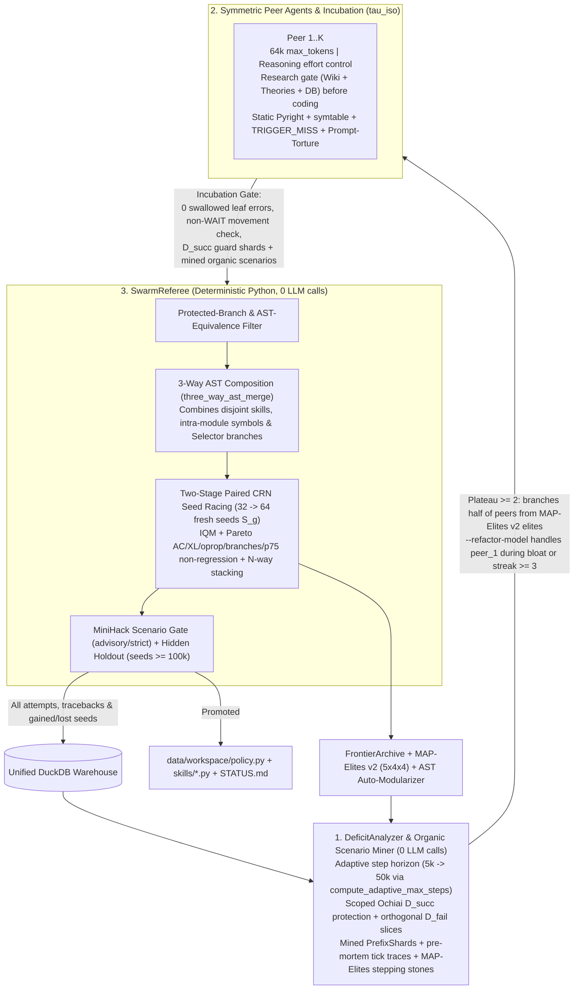

# LOX

**Autonomous empirical policy synthesis under one invariant: _Hard Code Nothing_.**

LOX designs, compiles, statically type-checks, instruments, and evolves Python 3.11+ Behavior Tree policies and modular `skills/*.py` packages for long-horizon stochastic environments with permadeath—primarily the **NetHack Learning Environment (NLE)**, with benchmark support for **MiniHack scenarios** and **Craftax**.

Instead of spending LLM tokens per action step or millions of shaped RL frames, LOX **separates synthesis from runtime execution**. Between generations, symmetric peer agents query DuckDB episode traces, human ascension logs, C symbol tables, and an untruncated offline NetHackWiki + 3.6.6 Guidebook index to synthesize Python code that executes directly against NLE C bindings at CPU speed.

---

## Contents

1. [Core Invariant: Hard Code Nothing](#1-core-invariant-hard-code-nothing)
2. [Peer Swarm Architecture & Tournament Pipeline](#2-peer-swarm-architecture--tournament-pipeline)
3. [Policy Language, StrategyStack, Type Checking & Contracts](#3-policy-language-strategystack-type-checking--contracts)
4. [Environment Harness, Scenarios & Rust Core](#4-environment-harness-scenarios--rust-core)
5. [DuckDB Warehouse, Quality-Diversity & Offline Wiki](#5-duckdb-warehouse-quality-diversity--offline-wiki)
6. [Single-Agent & Legacy Swarm Modes](#6-single-agent--legacy-swarm-modes)
7. [Repository Layout](#7-repository-layout)
8. [Setup, Verification & CLI Workflows](#8-setup-verification--cli-workflows)

---

## 1. Core Invariant: Hard Code Nothing

The harness, Rust extension, compiler, deficit analyzer, and tournament referee ([`lox/env/`](lox/env/), [`crates/lox-core/`](crates/lox-core/), [`lox/lang/`](lox/lang/), [`lox/engine/`](lox/engine/)) contain **zero** game strategy heuristics, **zero** hardcoded monster/corpse/item lists, and **zero** hidden tactical adapters. All domain intelligence lives strictly inside generated `policy.py` and `skills/*.py`.

| Boundary Layer | Responsibility | Implementation |
| :--- | :--- | :--- |
| **1-to-1 Action Map** | Direct mapping from policy outputs to NLE C keystrokes (`Action`, `key(ch)`, `seq(...)`, `repeat(...)`, `extcmd(...)`, `DIR_DELTAS`). | [`lox/env/actions.py`](lox/env/actions.py) |
| **Lazy State & WorldMemory** | Zero-copy `GameState` over `blstats`, `BL_MASK_*`, `worn_oprop_mask`, 21×79 `chars`/`glyphs`/`colors`, multi-floor `FloorMemory` (read-only `passable_mask`, trap-avoiding `safe_passable_mask`, `level_exits`, under-hero object occlusion clearing), and prompt flags (`in_getobj_prompt`, `in_getdir_prompt`, `in_yn_prompt`, `in_text_prompt`, `in_menu`). | [`lox/env/state.py`](lox/env/state.py) |
| **C Symbol Ground Truth** | Direct queries over NLE `permonst` (`level`, `speed`, `ac`, `mr`, `nutrition`, `cwt`, `conveys`, `resists`, `mflags1`–`3`) and `objclass` (`class`, `cost`, `weight`, `delay`, `prob`, `oprop`, `descr`). | [`lox/datasets/symbols.py`](lox/datasets/symbols.py) |
| **Safe Harness I/O** | Enforces `noautopickup` (`DEFAULT_NETHACKOPTIONS`), auto-clears `--More--` pagers, aborts broken `seq(...)` chains in 0 turns (`seq_aborted`), dismisses hung prompts, and truncates zero-turn stalls (`stalled_zero_turn`). | [`lox/env/harness.py`](lox/env/harness.py) |

---

## 2. Peer Swarm Architecture & Tournament Pipeline

The default swarm (`--swarm-architecture peer` in [`scripts/run_swarm.py`](scripts/run_swarm.py) and [`SwarmCampaignOrchestrator`](lox/engine/swarm_orchestrator.py)) runs a deterministic data-partition + parallel peer + CRN tournament loop:



### Key Safeguards Against Stalls, Bloat & Goodharting

1. **Fresh Paired CRN Racing + Hidden Holdout ([`swarm_referee.py`](lox/engine/swarm_referee.py))**:
   - Generation `g` evaluates Incumbent and finalists on fresh shared seeds `S_g = [10_000 + g*100 + i]`. With default `--seeds 64 --race-seeds 32`, stage 1 races finalists on `32` seeds and extends top individual + orthogonal contenders to the full `64` seeds.
   - Promotion requires passing exception/score/hard-stall guards plus progression gain (`avg_depth`, `iqm_delta`, or Pareto non-regression across `p75_depth`, `avg_ac`, `worn_oprop_count`, and `dungeons_visited`).
   - Top non-conflicting winning peers undergo **N-Way Sequential Greedy Stacking** before facing the optional `--scenario-gate` (`advisory` by default) and the **Hidden Holdout Audit** (`seeds >= 100,000`, never visible to peers).
2. **Pre-Rollout Peer Gates ([`agent.py`](lox/author/agent.py), [`tools.py`](lox/author/tools.py), [`swarm_peer.py`](lox/author/swarm_peer.py))**:
   - Mandatory research gate (`query_theories` + `query_wiki`) before first `dry_run_policy`, with automatic turn refunds so exploration never starves coding turns.
   - `AuthorAgent` defaults to `65536` `max_tokens` (`64k`) and rejects empty responses when internal reasoning exhausts tokens rather than parsing `<think>` text as code.
   - `dry_run_policy` checks cross-module signatures, `pyright` types against `.pyi` prelude stubs, `#EVOLVE-BLOCK` bounds, `TRIGGER_MISS` reachability on claimed failure fixtures, and `prompt_torture` checks; `incubate_candidate` rejects `WAIT`-dominant (`<= 10%` non-`WAIT`) deadlocks and runtime exceptions.
3. **Recency-Scoped Spectrum Attribution & Plateau Handling ([`summarizer.py`](lox/db/summarizer.py), [`swarm_deficits.py`](lox/author/swarm_deficits.py))**:
   - Weights `ochiai_good_run_score` by `(1 - min(0.85, stagnation_share))` and scopes `D_succ` branch protection to the latest 1–3 promoted champion batches (`< 0.35` stagnation).
   - `--refactor-model` optionally routes `peer_1` to a stronger reasoning model during bloat warnings or plateau streaks (`>= 3`).

---

## 3. Policy Language, StrategyStack, Type Checking & Contracts

- **Interruptible Behavior Trees & Stateful Plans ([`lox/lang/bt.py`](lox/lang/bt.py), [`lox/lang/strategy.py`](lox/lang/strategy.py))**:
  - `PrioritySelector`, `Sequence`, `MemorySequence`, `Inverter`, `ConditionLeaf`, `ActionLeaf` (`min_commit`, `preempt_if`, generator coroutine yields + `.halt()` cleanup), `@bt_leaf` declarative ordering, and `Blackboard.floor_get` / `floor_set` scoped to `(dungeon_num, level_num)`.
  - `StrategyStack` / `StrategyFrame` / `until` / `with_cleanup` support multi-turn stateful plans with automatic hazard preemption cleanly pre-loaded into the policy runtime.
- **Frozen Cross-Module Contracts ([`lox/lang/contracts.py`](lox/lang/contracts.py))**:
  - Typed runtime data contracts (`GoalIntent`, `SafetyReport`, `WorldTracker`, `CapabilityScorer`, `ThreatEvaluator`) + `#EVOLVE-BLOCK:<name>` bounds checking keep multi-skill interfaces stable across edits.
- **Static & AST Tooling ([`lox/lang/validator.py`](lox/lang/validator.py), [`lox/lang/compiler.py`](lox/lang/compiler.py))**:
  - Dynamic `.pyi` stubs (`_lox_prelude.pyi`) + `run_pyright_on_package`, `<2ms` CPython `symtable` undefined-symbol gate, topological `skills/*` compilation, `three_way_ast_merge`, AST security sandbox, and `<1 us` per-function instrumentation with loop watchdogs ([`lox/lang/instrument.py`](lox/lang/instrument.py)).

---

## 4. Environment Harness, Scenarios & Rust Core

- **MiniHack Scenario & Prompt-Torture Gate ([`lox/env/benchmarks/nethack_scenarios.py`](lox/env/benchmarks/nethack_scenarios.py))**:
  - Runs 7 procedural `.des` curriculum archetypes (locked doors/boulders/kicking, water/lava hazards, corpse/food handling, shopkeeping/altar/shop doors, blind/confused/faint recovery) plus 4 NLE C prompt-torture suites (`--More--` collisions, text naming prompts, `[ynq]` traps, inventory/menu pagers) via `run_scenario_gate`.
- **Native Rust Core ([`crates/lox-core/src/`](crates/lox-core/src/))**:
  - Release PyO3 extension `lox_core` accelerates `FloorMemory` updates (`fast_update_floor_memory`), frontier & exit extraction (`fast_unexplored_frontier_mask`, `fast_extract_exits`, `fast_trap_mask`), 21×79 BFS/A* (`fast_bfs_distance_grid`, `fast_astar_next_step`), and byte-stream replay (`fast_replay_action_bytes`), with Python/Numba fallbacks in [`lox/env/grid_utils.py`](lox/env/grid_utils.py).

---

## 5. DuckDB Warehouse, Quality-Diversity & Offline Wiki

| Store | Engine & Location | Role | Access / Tools |
| :--- | :--- | :--- | :--- |
| **Unified Telemetry & Theory Store** | Embedded DuckDB ([`schema.py`](lox/db/schema.py), [`theories.py`](lox/db/theories.py), `data/lox.duckdb`) | `batches`, `runs` (incl. `worn_oprop_count`, `dungeons_visited`, `unique_tiles` keyed per floor), `ticks`, `function_stats`, `policies`, `theories`, `tournament_attempts`, `experiments`, `discoveries`, `synthesis_logs`, `archive_policies`, `expert_runs` / `expert_ticks`. | `query_db`, `query_theories`, `benchmark_expert_parity` |
| **Go-Explore Frontier Archive** | Byte checkpoints ([`frontier.py`](lox/engine/frontier.py), `data/frontier/`) | Records deep trajectories (Dlvl 2+) and samples under-visited states via `depth / sqrt(visit_count + 1)`. | Replay probes & `mine_organic_scenarios` |
| **MAP-Elites v2 Archive** | 5×4×4 80-cell QD grid ([`map_elites.py`](lox/engine/map_elites.py)) | Non-aliasing `(avg_depth, vitals [AC/XL/branches], spatial tempo)` archive supporting `"ucb_curiosity"` and `"caution"` branching. | Plateau reseeding |
| **Offline Wiki + 3.6.6 Guidebook** | SQLite FTS5 BM25 ([`wiki.py`](lox/datasets/wiki.py), [`build_wiki_db.py`](scripts/build_wiki_db.py), `data/wiki_index.db`) | Built from official NetHackWiki XML dump (`4,964` articles, `7,937` redirects, variant namespaces excluded) + NetHack 3.6.6 `Guidebook.html`, with `AND`-tier matching, query sanitization, and untruncated section reads. | `query_wiki`, `read_wiki_article` |
| **Code Navigation Tools** | AST & Workspace Search ([`tools.py`](lox/author/tools.py)) | Inspect current or historical snapshots and cross-skill symbol usage without loading every skill blindly. | `read_policy`, `read_skill`, `diff_policies`, `find_references`, `grep_skills`, `blackboard_map` |

---

## 6. Single-Agent & Legacy Swarm Modes

- **Single-Agent Mode ([`scripts/run_lox.py`](scripts/run_lox.py), [`orchestrator.py`](lox/engine/orchestrator.py))**: Cycles `CREATE`, `WRITE` (`<= 2` functions), and `REFACTOR` (`--refactor-model` supported) using [`ModeScheduler`](lox/engine/scheduler.py), paired pilots (`--pilot-revisions 4`), CRN-SPSA parameter tuning ([`modes.py`](lox/engine/modes.py)), Confidence Sequences, Paired Wilcoxon tests, and Sequential Futility Early Stopping ([`hypothesis.py`](lox/engine/hypothesis.py)).
- **Legacy Hierarchical Swarm**: Earlier Critic/Meta/Worker topology remains available via `--swarm-architecture legacy`.

---

## 7. Repository Layout

```text
crates/lox-core/src/           # PyO3 Rust core (BFS/A*, FloorMemory, frontier/exit/trap masks, byte replay, BT)
lox/
├── core/contracts.py          # Typed EpisodeRun, BatchEvaluation, CandidatePackage invariant guards
├── env/                       # 1-to-1 actions, lazy GameState, WorldMemory, NLE harness, MiniHack scenarios, Craftax
├── lang/                      # BehaviorTree/StrategyStack/contracts, AST validator & 3-way merge, pyright/.pyi stubs, compiler
├── db/                        # DuckDB schema/logger, TheoryDocumentStore, RLE/Ochiai summarizer, PrefixShards
├── datasets/                  # Offline NetHackWiki + Guidebook FTS5, C symbol LUTs, expert downloader, frontier bootstrap
├── runner/pool.py             # Persistent multi-core worker pool with cancellation epochs & leaf error capture
├── author/                    # AuthorAgent, DeficitAnalyzer, SwarmPeerAgent, tools, prompts, bt_eval
├── engine/                    # SwarmCampaignOrchestrator, SwarmReferee, MAP-Elites v2, Frontier, Hypothesis
└── ui/console.py              # ANSI console progress & summary tables
scripts/                       # run_swarm.py, run_lox.py, status_lox.py, build_wiki_db.py, download_experts.py, calibrate_pilot.py, modularize_policy.py, reset_clean.py, build_core.sh
tests/                         # 158 automated unit & integration tests
```

---

## 8. Setup, Verification & CLI Workflows

### 1. Install, Build Rust Extension & Run Tests

```bash
uv sync
./scripts/build_core.sh          # builds & installs lox-core via maturin --release
uv run ruff check .
uv run ruff format --check .
uv run pytest -v                 # 158 tests
```

### 2. Build Untruncated Offline Wiki & Expert Corpus

```bash
# Downloads NetHackWiki XML + NetHack 3.6.6 Guidebook and builds data/wiki_index.db
uv run python scripts/build_wiki_db.py --download-xml

# Ingest real human ascensions into DuckDB expert_runs / expert_ticks
uv run python scripts/download_experts.py --max-ascensions 1000 --fetch-dumplogs 25
```

### 3. Run Peer Swarm Campaigns

```bash
export OPENROUTER_API_KEY="sk-or-v1-..."

# Fresh campaign (--clean resets workspace & campaign DuckDB tables, preserving expert_runs & wiki)
uv run python scripts/run_swarm.py \
  --clean \
  --provider openrouter \
  --model z-ai/glm-5.3-flash:nitro \
  --refactor-model <optional-stronger-model> \
  --reasoning-effort medium \
  --workers 4 \
  --turns-per-worker 3 \
  --seeds 64 \
  --race-seeds 32 \
  --scenario-gate advisory \
  --generations 50

# Resume an existing campaign (omit --clean)
uv run python scripts/run_swarm.py \
  --provider openrouter \
  --model z-ai/glm-5.3-flash:nitro \
  --generations 50
```

### 4. Offline Smoke Testing & Monitoring

```bash
# Mock end-to-end swarm check (zero API calls)
uv run python scripts/run_swarm.py --provider mock --generations 2 --workers 2 --turns-per-worker 1 --seeds 4 --race-seeds 2

# Read-only status dashboard, pilot calibration, and workspace summary
uv run python scripts/status_lox.py --since-hours 12
uv run python scripts/calibrate_pilot.py --db-path data/lox.duckdb
cat data/workspace/STATUS.md
```
